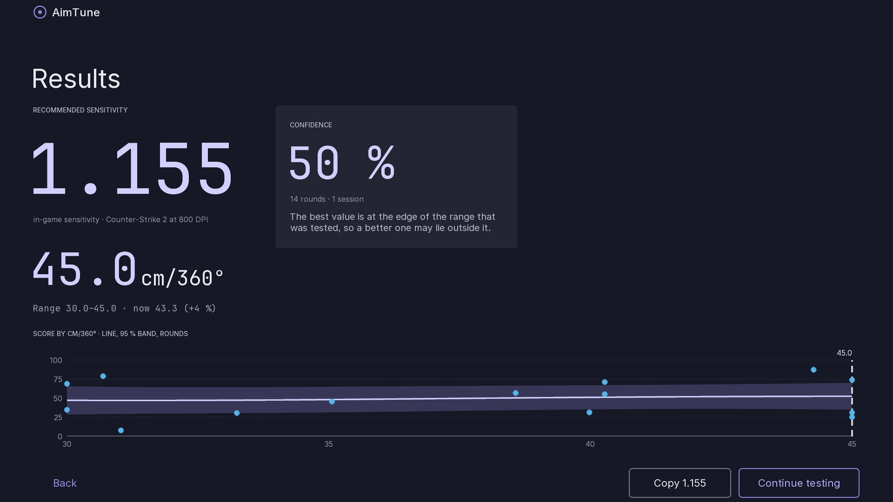
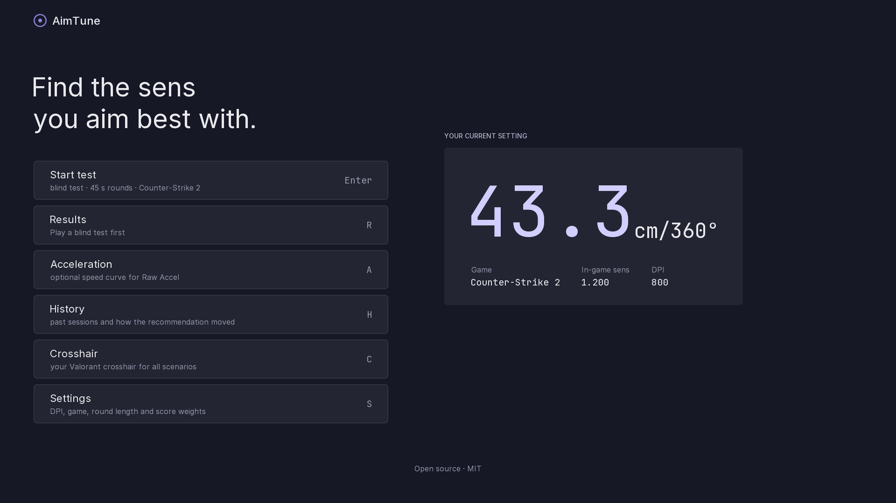
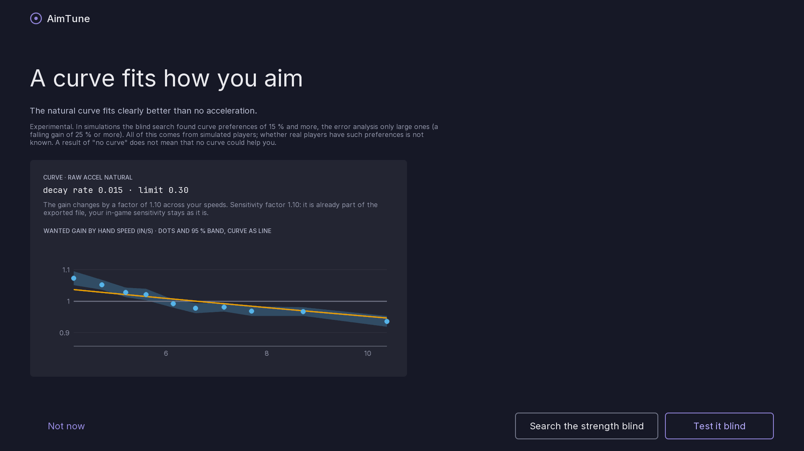
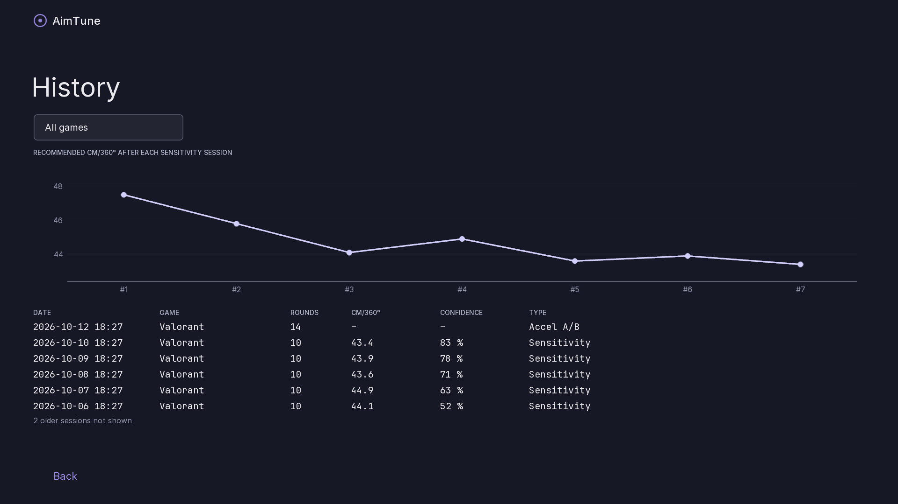
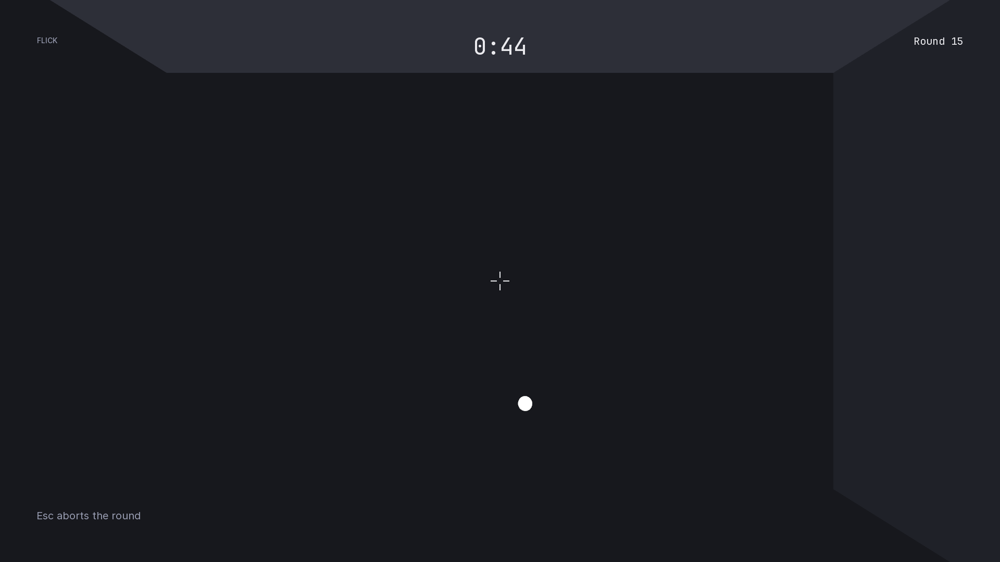
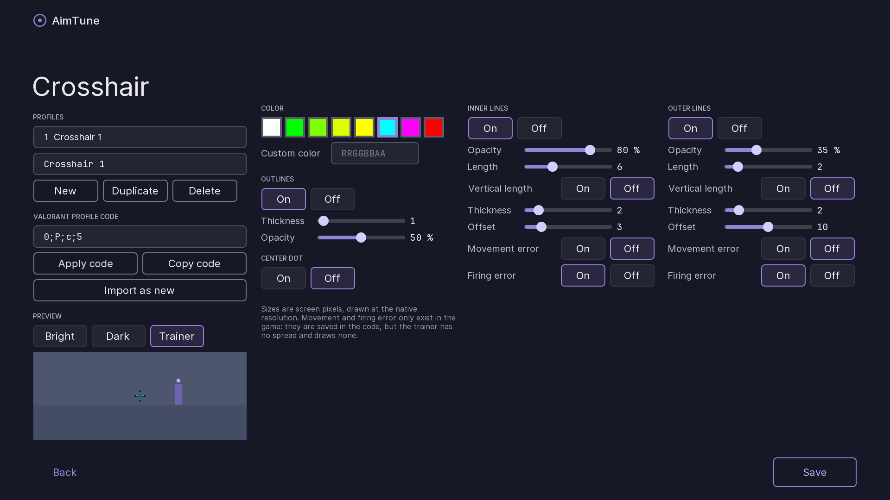
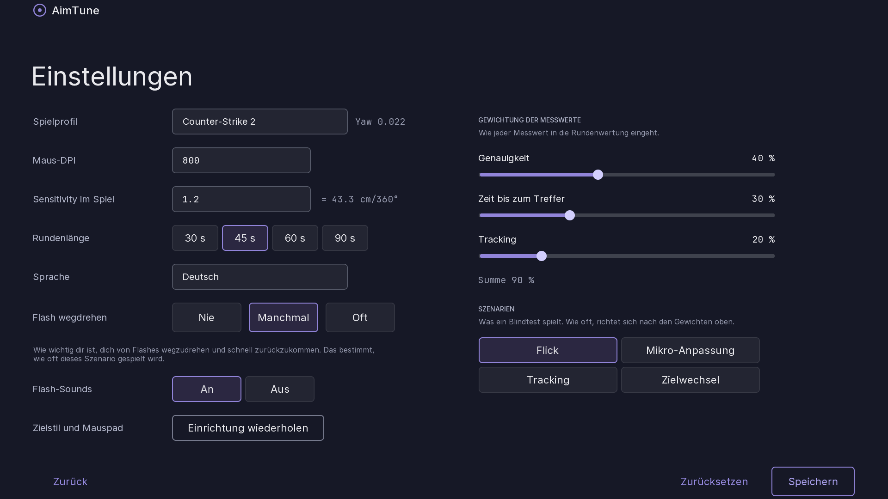
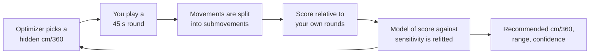

<div align="center">

# 🎯 AimTune

**Find the mouse sensitivity you aim best with, in a built-in 3D aim trainer, then convert it to your game and cm/360°.**

Blind rounds · Bayesian optimization · optional Raw Accel curve test

[](https://github.com/Yuutokata/Aim-Tuner/actions/workflows/ci.yml)
[](https://github.com/Yuutokata/Aim-Tuner/tags)
[](LICENSE)


[Install](#-install) ·
[How to use](#-how-to-use) ·
[How it works](#-how-it-works) ·
[Limitations](#-limitations) ·
[Build](#-build) ·
[Docs](#-documentation)

<br>



</div>

---

## ✨ What it does

| | |
| --- | --- |
| **Blind sensitivity search** | Short aim rounds in a 3D trainer at sensitivities chosen by a Bayesian optimizer. You never see which one you are playing, so your expectation cannot decide the result. |
| **Several round types** | Flick, micro-adjust, tracking, target switching, and turning away from a flash and back. Games with a shooting range profile (Valorant) also get **Range mode** with strafing bots. |
| **Your own crosshair** | Paste a Valorant profile code or build one in the editor, pixel-exact at your resolution, several profiles. Targets sit at head height on the floor of a small map, and the results say whether your misses are mostly vertical or horizontal ([crosshair format](docs/CROSSHAIR.md)). |
| **A result you can use** | The recommended sensitivity as your game's value and as cm/360°, the range in which your scores were equal, a confidence, and a history of sessions. |
| **Optional acceleration** *(experimental)* | Searches the strength of a speed-dependent curve blind, or analyses how your first movements miss, or lets you try a mild rising or falling one. Everything is tested blind against plain sensitivity, and a [Raw Accel](https://github.com/RawAccelOfficial/rawaccel) `settings.json` is exported only if the curve is clearly better. |
| **Raw Accel hub** | One place for everything about [Raw Accel](https://github.com/RawAccelOfficial/rawaccel): the sensitivity every run uses, finding or refining a curve, and a page for every other setting (rotation, Y/X, L/R, angle snapping, speed cap, smoothing and more) that says what it does, what your imported profile has, and what AimTune recommends and why. Rotation, Y/X and L/R are judged from your stored rounds; U/D shows its measured number only, angle snapping recommends 0° and shows a replay of your rounds, and the rest are explained. Recommendations only go into an exported copy if you tick them, marked as not blind-tested. |
| **Refine your Raw Accel curve** | Open your existing Raw Accel `settings.json` (native file dialog) and let the program search small changes to the curve around it, tested blind against your own profile. Every setting of the profile is played exactly as the Raw Accel driver would, and refine never changes your base (sensitivity, DPI, ratios, rotation). The export is a copy of your file with the refined profile added. In simulations it rarely finds a change worth exporting, and it says so. |
| **Share data for research** | History → *Share data for research* writes your stored rounds into one file (no name, paths or clock times) that you can send to someone who is checking the method. Nothing is uploaded ([format](docs/RESEARCH-EXPORT.md)). |
| **English and German** | |

<details>
<summary><b>📸 More screenshots</b></summary>

<br>

| Menu | Acceleration analysis |
| --- | --- |
|  |  |

| History | Blind round (map, head-height targets, your crosshair) |
| --- | --- |
|  |  |

| Crosshair editor | Settings in German |
| --- | --- |
|  |  |

The screenshots are rendered with sample data by `./gradlew :app:screenshots` (`:app:screenshotsDe` for German).

</details>

## 📦 Install

1. Download `AimTune-<version>-windows.zip` from the latest release and unzip it anywhere (or run the `-setup.exe` installer if the release has one).
2. Start `AimTune\AimTune.exe`. It brings its own Java runtime; nothing else has to be installed.
3. Windows may show a SmartScreen warning because the program is not code-signed yet: choose **More info**, then **Run anyway**.

> [!NOTE]
> The app checks once a day whether a newer release exists on GitHub and then shows a hint in the menu. Nothing is downloaded or installed. Switch it off in Settings or start with `--no-update-check`.

Settings and your rounds are stored in `%APPDATA%\AimTune` (set `AIMTUNE_DATA_DIR` to use another folder). Deleting that folder resets everything.

## 🚀 How to use

1. **Set up once.** Enter your mouse DPI, your game and its current sensitivity, how you aim and the size of your pad. Switch off *Enhance pointer precision* in Windows and any Raw Accel curve before you test.
2. **Start a test.** Rounds of 45 seconds: click the targets as fast and accurately as you can. After every round you see how many you hit and how sure the program is; the sensitivity of the round is never shown. Play 15 to 30 rounds, ideally on two different days; *Stop for today* is always available.
3. **Read the result.** The Results screen shows the recommended sensitivity as your game's value and as cm/360°, a range, and a confidence. Type the value into your game and aim with it for a few days before judging.
4. **Optional: acceleration.** The *Raw Accel* menu opens a hub: *Find a curve* looks for a speed-dependent curve, tests it blind against your normal sensitivity, and only offers a Raw Accel `settings.json` if it is clearly better; *Refine* starts from your own profile; the other pages explain every remaining setting. Most people will be told that no curve is clearly better, which is a normal answer.

**Controls:** click starts a round, `Esc` aborts it, `F11` switches fullscreen (kept for the next start), `F3` toggles the debug overlay.

## 🧠 How it works



- **Blind rounds.** The program plays short aim rounds at different sensitivities and hides which one. That way your expectation cannot decide the result.
- **A score per round.** Each round gets a score from how often your first shot hit and how fast you hit, compared with your own other rounds. The score is relative to you; it is not a rating.
- **A model of the score against sensitivity.** From the scores the program fits a smooth curve over sensitivity (a Gaussian process on cm/360°, on a log scale) and picks the next sensitivity to try where it learns the most. Rounds from earlier days are included and each day may have a different level; a steady change within a day (warming up, getting tired) is detected and lowers the confidence.
- **Confidence.** It is the chance that no other sensitivity in the tested range is noticeably better than the recommended one. It is not a promise about your game.
- **Targets.** The targets have the angular size of a head at typical distances, defined per game in `games/*.json`.

For the full explanation with diagrams, a glossary and all formulas, read **[docs/ALGORITHMS.md](docs/ALGORITHMS.md)**.

## ⚠️ Limitations

AimTune is honest about what it has and has not shown. Read this before you trust a number.

<details>
<summary><b>Show all limitations</b></summary>

<br>

- **The target sizes are estimates.** Riot publishes no head size or movement speeds, so the Valorant profile uses a head of about 0.2 m seen from 6 to 30 m. The pre-test notice says so until the values are measured in the game (see [docs/history/REVIEW.md](docs/history/REVIEW.md)). The recommended sensitivity depends on target size.
- **Checked against a simulated player, not against many people.** The method recovers the best sensitivity of a simulated player to within about 10-20 % at 15 rounds, but how well real people behave like it is not measured yet (see [docs/history/ASSESSMENT.md](docs/history/ASSESSMENT.md)).
- **The result is a range, not an exact value.** Controlled studies and the simulations agree that scores are flat around the best sensitivity: a difference of 15 % is below what a 45-second round can measure. The app shows the stretch in which your scores were equal, and says so when they were equal almost everywhere. Fatigue and learning can move the result; play on more than one day.
- **A clean aim test is not a game.** Nothing shows yet that the best sensitivity in a trainer is the best one in a match (movement, peeking, pressure); no study of that was found.
- **Acceleration is experimental.** In simulations the recommended blind search of the curve strength found preferences of 15 % and more, the optional error analysis only large ones (a falling gain of 25 % or more); all of it comes from simulated players, and whether real players have such preferences is not known. A result of "no curve" does not mean that no curve could help. No study of acceleration for first-person aiming was found, so how large real preferences are is unknown. In simulations the refine search found no preference in the shape of an imported curve either, because the curve barely acts where the simulated hand moves. A trial curve you ask for is tested blind, but right after switching any new curve scores worse than a familiar one. The exported Raw Accel file follows the 1.7.1 settings format but has not been loaded into Raw Accel by the author yet. The analysis needs a mouse report rate of 1000 Hz or more and Windows Raw Input.
- **Windows only**, and the window should be 16:9 or will be letterboxed to it (the FOV of the game at other shapes is unknown).

</details>

## 🔒 Safety

AimTune is built to be safe next to competitive games:

- It **never touches game processes**: no injection, no game memory, no input manipulation outside its own window.
- It **reads mouse input only while its own window is focused**, never outside it.
- It **never edits game configs**. Acceleration curves are only simulated in the app and exported as a file for [Raw Accel](https://github.com/RawAccelOfficial/rawaccel).

## 🛠️ Build

```bash
./gradlew build        # build and run the tests
./gradlew :app:run     # start the app
```

On first launch a four-step setup asks for your mouse DPI, game and current sensitivity, aim style and mousepad size; everything is stored in `%APPDATA%\AimTune\settings.json` and can be changed in Settings. Developer options (`--seed`, `--source`, `--no-vsync`, `--screenshots <dir>`, `--language <code>`, `--record <dir>`) are listed in `LaunchOptions.USAGE`.

Finished rounds are analysed (first-movement error, corrections, path efficiency) and stored in a local SQLite database in `%APPDATA%\AimTune` (set `AIMTUNE_DATA_DIR` to use another folder).

<details>
<summary><b>Packaging and JDK setup</b></summary>

<br>

To package the app with its own Java runtime: `./gradlew :app:jpackage` writes `app/build/jpackage/AimTune/AimTune.exe` (add `-PinstallerType=exe` or `msi` for an installer; that needs the WiX toolset). See [ADR 0005](docs/adr/0005-jpackage-without-plugin.md).

Gradle itself runs on whatever JDK `JAVA_HOME` points to (Gradle 9.6.0 supports JDK 17 up to 25). The project compiles for Java 21 through a Gradle toolchain, and the foojay resolver plugin downloads JDK 21 automatically if it isn't installed, so you don't need to install JDK 21 yourself.

</details>

**Project layout**

| Module | Purpose |
| --- | --- |
| `core` | Pure Kotlin logic: units, metrics, segmentation, Gaussian process, optimizer, acceleration fit, simulated player. No LibGDX, fully testable. |
| `games` | `GameProfile` and the JSON profiles in `games/`. |
| `input` | Mouse input: Windows Raw Input via JNA, GLFW fallback. |
| `storage` | SQLite and the settings JSON in `%APPDATA%\AimTune`. |
| `app` | LibGDX / Scene2D UI, scenarios rendering, i18n, packaging. |

## 📚 Documentation

| Document | What is in it |
| --- | --- |
| [Specification](docs/SPEC.md) | What the app does |
| [Architecture](docs/ARCHITECTURE.md) | How it is built |
| [Algorithms](docs/ALGORITHMS.md) | The method in plain words with diagrams, then every formula and measurement |
| [Design](docs/DESIGN.md) | UI and UX |
| [Range mode](docs/RANGE.md) | The Valorant shooting range model and how it was measured |
| [Crosshair](docs/CROSSHAIR.md) | The crosshair format |
| [Research export](docs/RESEARCH-EXPORT.md) | The "Share data for research" file |
| [Progress](docs/PROGRESS.md) | Current status and history of the work |
| [History](docs/history) | Older reviews, the independent assessment and the curve finder audit |
| [Contributing](CONTRIBUTING.md) | How to contribute and how to add a game |

## 📄 License

[MIT](LICENSE). Third-party components are listed in [THIRD-PARTY-NOTICES.md](THIRD-PARTY-NOTICES.md).
