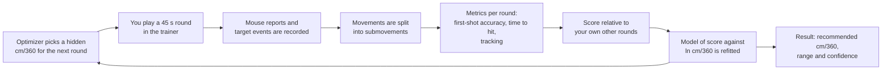
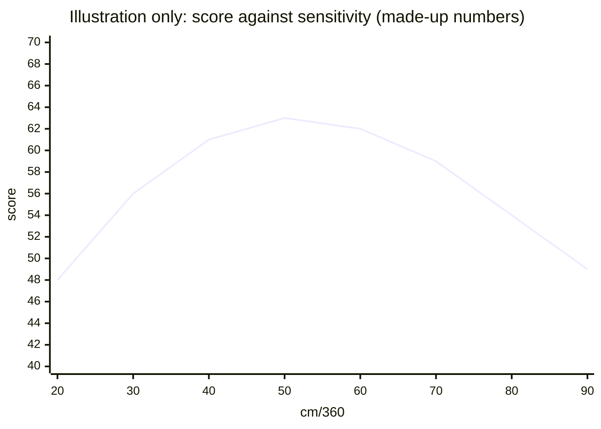
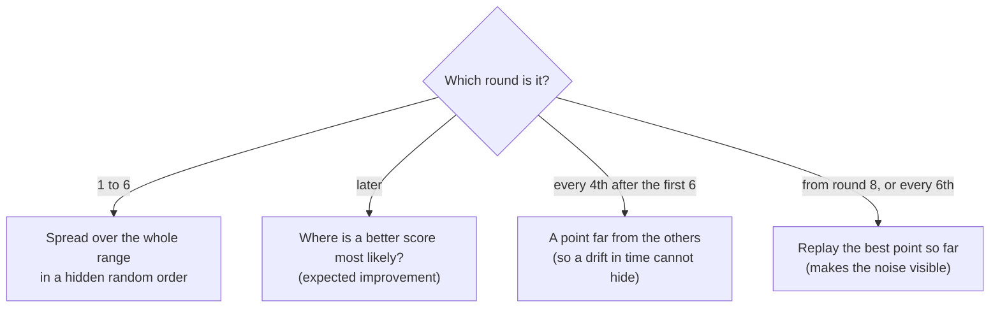
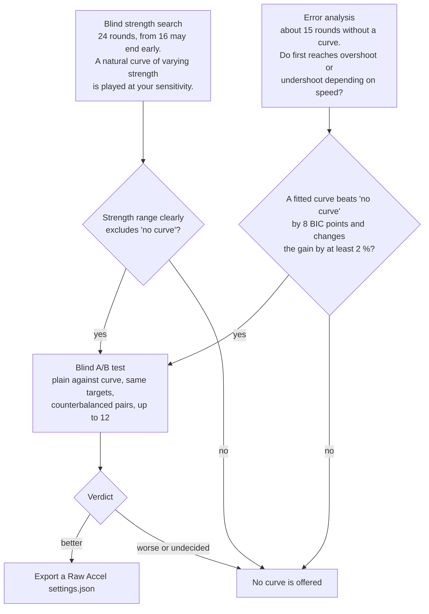

# Algorithms

How AimTune finds a sensitivity, and how it decides whether a Raw Accel curve helps. The file has two layers:

1. **Part 1 (this page, top)** explains the method in plain words with diagrams. Start here.
2. **Part 2 (below)** is the reference: every formula, parameter and measured result, grouped by topic and tagged with the milestone (M3, M5, ...) that introduced it. Open it when you want to check a number or change the code.

All numbers in Part 2 that describe how well the method works come from **simulated players**, unless a section says otherwise. See [README, Limitations](../README.md#limitations).

**Contents**

- [Part 1: The method in plain words](#part-1-the-method-in-plain-words)
  - [The problem](#the-problem)
  - [The loop](#the-loop)
  - [From mouse movement to a score](#from-mouse-movement-to-a-score)
  - [Choosing the next sensitivity](#choosing-the-next-sensitivity)
  - [Reading the result](#reading-the-result)
  - [Acceleration curves](#acceleration-curves)
  - [How the method is tested](#how-the-method-is-tested)
  - [Glossary](#glossary)
- [Part 2: Reference](#part-2-reference)

---

# Part 1: The method in plain words

## The problem

You cannot find your best mouse sensitivity by feel. After a few minutes you get used to whatever you play, and what you expect to be better feels better. AimTune therefore does three things:

- It measures sensitivity as **cm/360°**, the distance your mouse travels for a full turn. This is independent of the game, DPI and in-game units (`cm360 = 914.4 / (DPI × sens × yaw)`, see [Unit conversion](#unit-conversion)).
- It plays short aim rounds at different sensitivities and **hides which one** you are playing.
- It looks for the sensitivity at which your **own scores** are best, and says how sure it is.

## The loop



Typical use is 15 to 30 rounds, ideally on two days. The model is refitted after every round, and all stored rounds of earlier sessions with the same game and DPI take part ([Multi-session merging](#multi-session-merging-m5)).

## From mouse movement to a score

The score is the part that turns "how did that round go" into one number the optimizer can use.

| Step | What happens | Why | Reference |
| --- | --- | --- | --- |
| 1. Record | Every mouse report (counts and timestamp) and every target event is stored. | Metrics can be recomputed later from the raw data. | [Metrics and score](#metrics-and-score-m3-implemented-for-flick) |
| 2. Split | The speed of the hand is cut into **submovements**: a movement starts above 2 cm/s and ends after 30 ms below 1 cm/s; a deep valley in the speed inside a movement splits it. | A reach to a target is a fast ballistic part followed by small corrections. | [Submovement segmentation](#submovement-segmentation-m3-implemented) |
| 3. Find the first reach | For each target, the first submovement that really goes toward it (peak at least 120 ms after the target appeared, covers at least 25 % of the distance). | Leftover motion from the previous click is not an aim. | [Metrics and score](#metrics-and-score-m3-implemented-for-flick) |
| 4. Measure | First-shot accuracy, time to hit, tracking (share of time on target), and as diagnostics the signed error of the first reach, corrections and path efficiency. | Overshoot and undershoot of the first reach also feed the acceleration analysis. | [Metrics and score](#metrics-and-score-m3-implemented-for-flick) |
| 5. Score | Each metric is compared with your own rounds (mean and standard deviation per scenario), turned into a percentile, and combined with weights (default accuracy 40, time to hit 30, tracking 20). | A trainer round is easier or harder depending on the scenario; the score must only reflect the sensitivity. | [Metrics and score](#metrics-and-score-m3-implemented-for-flick), [Scenarios](#scenarios-score-combination-and-the-schedule-m6) |

A score is **relative to you**: a round that is one standard deviation better than your average on every metric scores 100 · Φ(1) ≈ 84, an average round 50. It is not a rating and cannot be compared between people.

## Choosing the next sensitivity

The program models the score as a smooth function of `x = ln(cm/360)`. The logarithm is used because a 10 % change in sensitivity feels about the same at 30 and at 60 cm/360. The model is a **Gaussian process**, a way of saying "scores of similar sensitivities are similar, and every round is noisy", fitted to all rounds at once.

The shape you should expect is a broad hill:



The top of the hill is flat: in simulations a player loses under 2 points between 38 and 73 cm/360. That is why the result is a **range**, not a single number.

Which sensitivity is played next ([Bayesian optimization](#bayesian-optimization-m5-implemented-in-coreoptimizer)):



Two things make the fit robust against real people:

- **Sessions.** Each day gets its own offset ("a good day or a bad day"), which the model integrates out, so day-to-day shifts do not move the optimum.
- **Drift.** If scores rise or fall steadily inside a session (warming up, getting tired), a per-session slope absorbs it and the confidence is capped at 60 %.

## Reading the result

After 3 rounds the program can analyse. It draws 400 plausible score curves from the model and reports:

| Output | Meaning |
| --- | --- |
| **Recommended cm/360** | The top of the fitted curve, refined by a parabola. Shown as your game's value and as cm/360°. |
| **Range** | The central 80 % interval of the best cm/360 over the 400 curves. |
| **Confidence** | The share of curves in which the recommendation loses at most a *negligible* difference (the larger of 0.5 points and 20 % of the standard deviation of your round scores) against that curve's own best. It answers "could another value be noticeably better?". It is **not** a promise about your game. |

The confidence is capped at 50 % below 10 rounds and when the best value sits at an end of the searched range; it is capped at 60 % when drift was detected. More rounds are recommended while it is under 85 %. In the simulations the confidence was conservative rather than overconfident ([calibration](#bayesian-optimization-m5-implemented-in-coreoptimizer)).

## Acceleration curves

A speed-dependent curve (a [Raw Accel](https://github.com/RawAccelOfficial/rawaccel) profile) changes the gain with the speed of your hand. AimTune never changes your mouse: it **simulates** the curve in its trainer and exports a file. A curve is only offered if it wins a blind test.



Rules that keep this safe ([Acceleration](#acceleration-m7), Curve safety):

- **The test decides, not the analysis.** After every pair from the fourth on, a one-sided t bound at the 1 % level decides. A verdict needs at least 6 pairs and a mean difference of at least 2 score points. With no real difference the test said "better" in 2.0 % and "worse" in 3.0 % of 500 simulated runs.
- **Falling curves need a clearer result than rising ones** (the upper end of the range below 0.90), because falling results were the ones found on noise most often.
- **"Last search" and "Last analysis" never export.** They offer a blind test of the stored result first.
- **Most people are told that no curve is clearly better**, which is a normal answer. The analysis finds a falling gain of 25 % or more; smaller rising preferences are missed.

**Refine my Raw Accel curve.** If you already have a profile, you can import it instead of searching from plain. The program plays your profile, then searches three factors in turn (the overall level, the gain at high speed, the width of the transition) around the imported values, 12 rounds each after 8 warm-up rounds, and tests the result against your own profile in the same blind A/B test. The export is a copy of your file with the refined profile added; your other profiles stay untouched ([Refine my Raw Accel curve](#acceleration-m7), M18).

## How the method is tested

There are no recordings of many players yet, so correctness is checked against a **simulated player** (`core/sim`): a hand with noise, a reaction time and a preferred gain, aiming in the same trainer code. The tests ask, for example:

- Does the optimizer find the best sensitivity of a simulated player within about 10-20 % at 15 rounds?
- Does a flat player (no preference) get a curve offered? (Target: never.)
- Does the blind test call a curve better when there is none? (Target: rarely; measured 2.0 %.)

These gates are in the reference part: [Verification harness](#verification-harness-simulated-player-implemented), [Player models](#player-models-of-the-gate-harness-m14). Whether real people behave like the simulated one is not measured yet.

## Glossary

| Term | Meaning |
| --- | --- |
| **cm/360°** | Distance the mouse moves for a 360° turn in the game. Lower is faster. |
| **Round** | One 45 s trainer run at one hidden sensitivity. |
| **Scenario** | A type of round: flick, micro-adjust, target switching, tracking, flash turn-away, range. |
| **Submovement** | One speed peak of the hand; a reach is a ballistic submovement plus corrections. |
| **First reach / signed error** | The first submovement toward a target, and how far it overshot (+) or undershot (−) the target, as a share of the distance. |
| **Score** | Weighted percentile of a round's metrics against your other rounds. |
| **Gaussian process** | A model that estimates a smooth curve (score against sensitivity) and its uncertainty from noisy points. |
| **Expected improvement** | The rule that picks the point where a better score is most likely. |
| **Credible interval** | The range in which the best value lies with 80 % probability under the model. |
| **BIC** | A fit criterion that penalises extra parameters; used to compare "curve" against "no curve". |
| **A/B pair** | Two rounds with the same targets, one with the curve and one without. |
| **Raw Accel** | A third-party mouse driver that applies acceleration curves; AimTune only writes its `settings.json`. |

---

# Part 2: Reference

The sections are grouped by topic. Each one carries the milestone that introduced or last changed it.

**Group: The core method: units, movements, score, optimizer**

## Unit conversion

`cm360 = (360 × 2.54) / (DPI × sens × yaw)`; inverse `sens = (360 × 2.54) / (DPI × yaw × cm360)`. Example: 800 DPI, sens 0.249, yaw 0.07 → 914.4 / 13.944 ≈ 65.58 cm/360°. Sensitivity is rounded per the profile's format only on output.

## Search range (M4, implemented)

`SearchRangeTable.DEFAULT` gives a window per aim style (wrist 20-35, mixed 30-50, arm 45-80 cm/360°, from the onboarding mockup; to be tuned). `searchRange()` (changed in M9, docs/history/REVIEW.md M1): the range reaches at least 1.6x below and above the current value (centred on it in log space), is widened to the style window, and is trimmed to a ratio of 6 if the style window and the current value are far apart (the style side gives way; the current value keeps a 1.2x margin to both ends). The pad width no longer shapes the range: players lift the mouse for long turns, and capping at the pad width used to end the range 10 % above the current value for small pads (mixed style, 32 cm pad, 65.6 cm/360°: 24.6-72.2, now 30-105). The pad only drives a hint in onboarding. Onboarding refuses a sensitivity that makes a turn shorter than 3 cm or longer than 6 m.

## Submovement segmentation (M3, implemented)

Input: the round's mouse reports (counts, timestamps) and the DPI. Code: `core/analysis/SubmovementSegmentation.kt`.

1. **Speed profile.** Counts are summed into 1 ms bins, the x and y bin vectors are smoothed with a centered 7-bin moving average (smoothing the vectors, not the magnitude, avoids rectifying noise), and the speed is the vector length in counts/ms.
2. **Thresholds in physical units.** Speeds are compared in cm/s so they do not depend on DPI: a movement starts when the speed exceeds 2 cm/s and ends after the speed has stayed below 1 cm/s for 30 ms (hysteresis). The start is moved back to where the speed last exceeded the lower threshold. Movements shorter than 30 ms are dropped. At 800 DPI one count per ms is 3.2 cm/s, so isolated single-count jitter never reaches the start threshold after smoothing.
3. **Splitting.** Inside a movement, the local maxima and minima of the speed form an alternating peak/valley list. A valley is a real split only if its speed is at most 40 % of the lower neighbouring peak, both neighbouring peaks are at least twice the start threshold, and both resulting submovements last at least 40 ms. The valley that violates this most is removed first, merging it with the lower neighbouring peak, until none is left. This is the usual velocity-minimum decomposition of aimed movements into a ballistic phase and corrections.
4. **Output per submovement:** start, peak time, end, summed `dx`/`dy`, path length (sum of per-report step lengths) and peak speed in counts/ms (the unit Raw Accel uses, verified in M7).

Checked on 20 real rounds (1114 click movements, 1 kHz mouse) in the M9 review: 123 submovements per 45 s round, median duration 229 ms, median peak speed 5 in/s. The segmentation itself is fine; the choice of the *first reach* among the submovements was not (next section).

The defaults are `SegmentationParams`; they were checked on synthetic minimum-jerk reaches (single flick, diagonal reach, two separate movements, a correction that overlaps the first reach, a slow smooth movement, 1 kHz vs 8 kHz). They are starting values and are re-tuned against real recordings and the simulated player in M5/M7.

## Metrics and score (M3, implemented for flick)

Code: `core/metrics/RoundMetrics.kt`, `core/score/ScoreCalculator.kt`.

**View reconstruction.** The view starts at yaw 0, pitch 0 at round start and is rebuilt from the recorded counts and the active `cm360` (`ViewTrack`), so every metric can be recomputed from the stored raw data.

**Per movement** (target spawn to the hit on it; targets under 2° from the crosshair at spawn are skipped):

- Target offset `T` on the screen plane in degrees: yaw difference scaled by cos(target pitch), pitch difference. `D0 = |T|`.
- First reach = the first submovement whose peak lies between the start of the reach and the hit **and which is a reach toward the target** (M9, docs/history/REVIEW.md C2): its peak comes at least 120 ms after a target appeared (not applied to targets that were already visible, where the player may be moving before the previous hit; the peak, not the start, because the slow start of a smooth reach is found early), it moves toward the target, and it covers at least 25 % of the distance. Leftover motion from the previous click and tremor fragments are not first reaches. On the 20 real rounds this took the share of first errors below -0.5 from 15 % to 2.7 % (the median error stayed at -0.01), and 1113 of 1114 movements have a first reach. Its view displacement `d` is measured the same way. **Signed endpoint error** `e = (d·T/|T| − D0) / D0`: `> 0` overshoot, `< 0` undershoot. This is the quantity the accel analysis (M7) uses together with the submovement's peak speed.
- Corrective submovements = submovements in the window minus one.
- Path efficiency = `D0 / (angular path travelled between spawn and hit)`, capped at 1.
- Time to target = spawn to hit; reaction = spawn to the first submovement's start.

The cos(pitch) scaling is a small-angle approximation; targets are within ±25° pitch, where the error is a few percent at most.

**Per round:** accuracy = hits / shots, mean time to hit, mean signed and mean absolute first-movement error, mean corrective submovements, mean path efficiency, and `errorSpread` = sample standard deviation of the signed first-movement errors.

**Consistency** is `errorSpread`; lower is better. It measures how repeatable the first movement is, independent of its average bias. Since M9 it is a diagnostic only and does not enter the score (docs/history/REVIEW.md C3): the relative error spread falls steadily as the sensitivity gets lower, because the hand's fixed noise shrinks in degrees, so on the simulated player consistency alone had its best value at the slow edge of the grid (149 cm/360° against about 45 for accuracy or time to hit) and pulled the combined optimum from 45 to 65 cm/360° when weighted heavily.

**Accuracy** is the first-shot accuracy (M9, docs/history/REVIEW.md M6): the share of reaches whose first click, counted since the round began or since the last hit, hit. A second click after a miss costs time (time to hit) but does not repair the first shot; plain hits per click is still shown to the user.

**Score.** Metrics of a round are `accuracy` (higher better), `time to hit` (lower better), `consistency` (lower better) and, from M6, `tracking` (higher better). Over all rounds given to the calculator, each metric gets a baseline (mean and sample SD) and a round's metric becomes `z = ±(x − mean) / SD` (sign flipped when lower is better). The metric score is `100 · Φ(z)` with Φ the normal CDF, and the round score is the weighted mean over the scoring metrics that round has, with weights renormalized (defaults: accuracy 40, time to hit 30, tracking 20). Baselines are kept per scenario when the scenarios are given (a micro round is easier than a flick round; pooled, they would only measure the scenario). A metric with fewer than 3 rounds (in that scenario), or without variation, has no baseline and is ignored; a round with no usable metric has no score. No population priors are invented: the baseline is the user's own rounds, so scores are relative to the user and recomputed whenever rounds are added. The 0-100 mapping and baseline window are revisited in M5 when the optimizer consumes scores.

## Bayesian optimization (M5, implemented in `core/optimizer`)

**Model.** `x = ln(cm360)`. Round scores (0-100, computed over all rounds together, see "Metrics and score") are standardized and modelled as `y = f(x) + offset(session) + noise` with a Matern 5/2 prior on `f`. The session offset (a better or worse day) is integrated out by adding a "same session" covariance `tau^2` to the kernel matrix, so rounds of many sessions give one estimate of `f` without a day-to-day shift biasing the optimum. Hyperparameters (lengthscale 0.12-0.7 times the log width of the search range, signal variance, noise variance 0.15-1.2, session variance 0 / 0.1 / 0.4, scenario variance 0 / 0.4) are picked from a small grid by marginal likelihood. The noise floor is deliberately not tiny: with few rounds a near-zero noise estimate gives an overconfident fit. Cholesky is hand-written (ADR 0004 amendment).

**Choosing the next sensitivity** (`suggestNext`, a pure function of the history and a seed, so a test can be stopped and continued):
1. Rounds 1-6: a seeded, shuffled, stratified design over the log range (hidden random order).
2. Afterwards: expected improvement over the best posterior mean on a 121-point grid, excluding values within 3 % of the previous round's.
3. Repeats: from round 8 on, if no point has been tested twice in a session, or every 6th round, the tested point with the best posterior mean is replayed, so the noise is observable.

**Drift (M9, docs/history/REVIEW.md M2).** Observations carry their position in the session (`step`). The model adds a per-session slope, integrated out like the session offset (`trendVariance * step_i * step_j` for rounds of the same session), so a steady change of the scores within a session (warming up, tiring) is not read as a better or worse sensitivity. The trend is searched around the best fit without one and taken only if it raises the log marginal likelihood by more than 1. If the fit takes a trend, `driftDetected` is set, the confidence is capped at 60 % and the app says the scores changed during the session. Every fourth round after the initial design is again a space-filling point, so sensitivities spread over the whole run and a drift in time cannot hide behind the clustering of exploitation rounds. The hyperparameters are searched on the newest 150 rounds only (the fit uses all of them), which keeps long histories fast. On the simulated player (40 seeds, 30 rounds) drift made the fit take a trend in 83-100 % of runs, and in 23-33 % of runs without drift; with strong drift the confidence dropped from 93 % to about 60 %. The recommendation itself is still pulled by strong fatigue or learning, because in the simulation the drift changes the best sensitivity itself (a noisier hand prefers a lower sensitivity): a score offset cannot repair that, so the app warns instead.

**Result** (`analyze`, from 3 rounds on): the argmax of the posterior mean refined by a parabola, plus 400 posterior draws of `f` on the grid. From the draws:
- the central 80 % interval of the best cm/360 ("Range 38-46"),
- the expected regret (score points lost by choosing the estimate instead of the true best),
- the confidence: the share of draws in which the estimate loses at most `negligible = max(0.5, 0.2 * sd of the round scores)` points against that draw's best. Below 10 rounds, or when the best value lies within 2 % of the log width of an end of the searched range, it is capped at 50 %; the result then carries `atRangeEdge`.
More rounds are recommended while the confidence is under 85 %; "about N more rounds" assumes the failure share shrinks like 1/rounds and is only a rough guide.

**Calibration measured in M9** (60 seeds x 5 simulated players x 8/12/20/30 rounds, ground truth from a dense reference sweep per player, `review-calibration.txt`): the confidence is conservative, not overconfident. At 30 rounds the runs that reported 60-79 % had a true loss within the negligible difference in 96 % and were within x1.3 of the truth in 92 %; those that reported 80 % or more 100 % and 99 %. The 80 % credible interval covered the truth in 89-95 % of the runs (a truth at the very edge of the range is the exception and is flagged). With a drift in the scores the confidence was overconfident until the trend term (above) and its cap. These numbers describe the simulated player only.

**Why this confidence and not the interval width.** Scores are flat near the optimum (the simulated player loses under 2 points between 38 and 73 cm/360), so the argmax interval stays wide however many rounds are played, while any value in it is practically as good. The loss-based number answers the question that matters: could a different value be noticeably better. The interval is still shown.

**Measured on the simulated player** (12 seeds, 28 rounds, tolerance x1.3 around the truth): 67-83 % of runs within tolerance, against 67-92 % for the 36-round grid baseline, so the optimizer reaches about the same accuracy with 22 % fewer rounds, not a dramatic gain (`core/build/reports/harness/optimizer-convergence.txt`). Calibration over 120 runs: runs reporting 80 % or more confidence were within x1.3 of the truth 96 % of the time, 60-80 % confidence 78 %, below 40 % only 57 %.

## Multi-session merging (M5)

Rounds with the same game and DPI from all sessions enter one fit; each blind-test run is its own session for the offset term. Scores are recomputed over all of them every time. See `SensitivityOptimizerTest` (merged sessions with a 10 point worse second day).

## Scenarios, score combination and the schedule (M6)

**Scenarios.** Flick: one target at a time, at least 15 degrees from the previous one. Micro-adjust: radius 0.15 m at 10-14 m, each target 2.5-9 degrees from the previous one. Target switching: three targets visible, a hit replaces only that one (at least 14 degrees from the others and from the hit one). Tracking: one target of radius 0.5 m at 14 m moving in straight segments of 1.2-2.8 s at 6-22 degrees per second (the first version, 12-40 degrees per second in 0.5-1.4 s segments, was too fast and twitchy for a person to follow) inside a +-35 / +-15 degree field; no clicks. Speeds and headings of the segments are stratified (spread evenly over their ranges in random order), so every round is about equally hard; without this the path alone moved the on-target time by as much as the sensitivity did.

**Movements with several targets.** A reach runs from the later of the target's spawn and the previous hit to the hit on it, and time to hit is measured the same way. With one target at a time this is the spawn, as before.

**Tracking metric.** The round is sampled every 10 ms from the first spawn; the crosshair is on target when its angle to the target centre is at most the target's angular radius. `tracking = on-target samples / samples` (higher is better, feeds `TRACKING`); the mean angle is stored as `tracking_mean_distance_deg`. Tracking rounds have no hits, so they only produce the tracking metric; the other scenarios produce accuracy, time to hit and consistency.

**Score combination.** The round score is the weighted mean of the metrics the round has (see "Metrics and score"), against the baselines of its scenario. The weights also decide how often a scenario is played, because a round only measures its own scenario: the weight of each metric is split among the enabled scenarios that produce it, and a scenario's share of the rounds is the sum of its metrics' weights. With the default weights and all scenarios on, tracking gets 20 % of the rounds and flick, micro and switching 26.7 % each. A scenario whose metrics all weigh 0 is not played. The flash scenario (M10) counts only for its dodge metric here, see "Flash turn-away". The plan is smooth weighted round robin, so scenarios are spread evenly and the plan for a round index never changes. The optimizer sees one pooled set of scores, so it maximizes the weighted average of the scenarios' score curves.

**Optimizer changes for mixed scenarios.** Observations carry a group (the scenario) and the kernel has a "same group" term like the session term, chosen by marginal likelihood. In the simulation the fit never chose it, because the per-scenario scores already have the same mean; it is cheap insurance. Lengthscale factor 1.2 was dropped: with it the fit became almost linear and in one of 16 mixed runs the optimum ran to the edge of the range with high confidence. A best value at the edge is now flagged and its confidence capped, because a slope only shows that the optimum may lie outside the range.

**Simulated player, new scenarios.** Switching: the aimer goes for the visible target nearest to its aim and keeps it; a target that was already visible is re-acquired after `reacquireMs` (110 ms) instead of the full reaction time. Tracking: every 40 ms the aimer sees the target as it was `trackingLagMs` (150 ms) ago, estimates its velocity, anticipates `trackingPrediction` (80 %) of the motion during the delay plus half a reach, and commands `trackingGain` (70 %) of the remaining error as an 80 ms minimum-jerk reach. The command is limited by `trackingMaxHandSpeedCmPerS` (4 cm/s, which hurts a high cm/360 on fast segments) and perturbed by signal-dependent noise plus `trackingNoiseShare` (2x) times the flick hand noise (which hurts a low cm/360). These parameters are hand-tuned for a clear optimum, like the flick model.

**Measured on the simulated player** (45 s rounds, 13 grid points, 12 rounds each, `scenario-sweeps.txt`): flick scores peak at about 49 cm/360, target switching at about 59, tracking at about 64 (on target 0.29 at 20 cm/360, 0.66 at 53-73, 0.33 at 140). Micro-adjust keeps improving up to the largest value of the range (precision on tiny targets, no travel-time penalty), so its optimum is the edge. A blind test of 30 rounds with all four scenarios and the default weights (16 seeds, `mixed-scenarios.txt`) ended within a factor 1.3 of the weighted blend of the four curves (65 cm/360) in 94 % of the runs, with a median loss against the blend of 0.6 score points (with the faster first tracking version: 69 %). Flick only: 88 % within 1.3 (8 seeds). Mixed tests are less certain than flick-only tests for the same number of rounds, because each scenario gets only a fraction of them, and a scenario needs 3 rounds of its own before its rounds have a score (until then they count as a neutral 50 and carry no information). With the real app a user with 9 rounds in 3 sessions and all four scenarios on saw 19 % confidence, which is why flick only is the default. These numbers describe the simulated player only.

**Group: The trainer world: geometry, targets, scenarios**

## Trainer geometry (M9, docs/history/REVIEW.md C1/M5)

Targets are defined by angle, not by size in the world. A game profile (`trainer` block in `games/*.json`, `TrainerGeometry` in `core`) holds: the angular diameter range of a click target (a head), drawn log-uniformly; the distance range the targets are drawn at (only the depth of the scene; the sphere radius follows from angle and distance, `r = d sin(a/2)`); the mix of angles between consecutive flick targets (where the crosshair is after a hit) as weighted buckets; the step range of micro-adjust targets; the separation of switching targets; the angular size, distance, strafe speed range and stop probability of the tracked target (the angular speed is `v / d`; a "stop" is a segment without motion, a counter-strafe). The scenarios take all of it from the profile; without a geometry they keep the fixed values of M2-M8 (`FlickConfig` etc. defaults), which the simulation harness was calibrated on.

Defaults (Valorant, `verified: false`): click targets 0.4-1.9° (a head about 0.2 m seen from 6-30 m), flick angles 30 % up to 5°, 30 % up to 10°, 20 % up to 20°, 15 % up to 40°, 5 % up to 90°, tracking target 2.0-3.7° at 14 m, strafe 3-6 m/s (12-25°/s at 14 m), 25 % stops. **These are assumptions.** Riot publishes no hitbox or speed numbers; the sources found are community statements: all agents share one hitbox size, the head is about 13 % of the standing body height (Reddit measurement on the Jett model), head hitboxes were larger in the beta and were reduced later. Nothing was extracted from the game. The pre-test notice says "estimate" until `verified` is true. How to measure a head with the mouse in the shooting range is in docs/history/REVIEW.md ("Realism"). Why this matters: on the simulated player the optimum moved from 117 cm/360° at head-sized targets (r = 0.10 m) to 54 cm/360° at the old r = 0.25 m, about x0.64 per doubling of the radius.

The trainer draws the scene in a viewport letterboxed to the profile's `trainerAspect` (16:9 by default), so the horizontal FOV is the game's value at that shape and does not depend on the window shape (Valorant: 103° at 16:9, which `UnitChainTest` checks through the projection). How Valorant scales its FOV at other shapes is not documented and sources conflict, so the trainer does not guess.

## Vertical distribution and the map (M11)

Until M10 the targets of flick and switching were drawn uniformly in a field of +-50 x +-25 degrees, the micro steps and flash returns in random directions, tracking with half of its movement vertical: players trained large vertical movements that Valorant fights hardly contain (maps are mostly flat, enemies stand where the crosshair is placed). The profile now holds (`trainer`, `TrainerGeometry`, `ElevationMix`, `ArenaLayout`):

- `eyeHeightMeters` 1.6 and `headHeightMeters` 1.65: the pitch of a head on the player's level at distance d is `atan((head - eye) / d)` (+0.3 degrees at 10 m). **Assumptions**: Riot publishes no eye or head height (secondary sources say all agents are about 2 m tall); to be measured in the shooting range with the procedure of docs/history/REVIEW.md "Realism".
- `elevation`: 88 % of the targets at head level with a normal spread of 1.5 degrees, 12 % on another level 3-10 degrees up or down (40 % of those below the player). Assumptions as well: heaven positions, ramps, stairs and crouching players exist, but there is no published statistic. The field limit (`fieldPitchDegrees`, 25) stays the hard bound. `elevation.uniform` restores the old field for comparisons.
- Flick and micro steps (`placeNearLevel`): the pitch of the next target is drawn from the distribution first, limited to 90 % of the flick angle; the rest of the angle goes into yaw, to the side that stays in the field. So flicks are mostly horizontal and keep their angle from the mix. Switching draws pitch from the distribution; tracking has a pitch share of 0.1 (0.5 before) within +-4 degrees; flash cues are at most 12 degrees above or below the view, the returning enemy is placed with the same rule as a flick target.
- Map (`arena`): floor at eye height below the camera, a ring wall at 36 m, pillars at corners and door frames at doorways at 8 fixed yaw/distance pairs. For 30 % of the flick and switching targets (`featureShare`) the nearest feature within 2.5 degrees of the drawn yaw replaces yaw and distance, so enemies stand at corners and in doorways, where crosshair placement counts; the target keeps its height relative to head level. Angular size does not change (the radius follows the new distance). Micro, tracking and flash do not use features. The scene draws a column from the floor to the bottom of every head-sized target.
- Vertical sensitivity: no separate vertical multiplier was found for Valorant (pitch uses the same 0.07 degrees per count as yaw) and none exists in the code (one `degreesPerCount` for both axes); a `pitchMultiplier` in the profile can be added when a game needs one.
- Metrics: the first movement's endpoint is split into a horizontal and a vertical error (screen-plane degrees, `firstErrorHDegrees` > 0 right of the target, `firstErrorVDegrees` > 0 above it). Rounds store `mean_abs_first_error_h_deg`, `mean_abs_first_error_v_deg` and `mean_first_error_v_deg` (`METRICS_VERSION` 3, older rounds are recomputed from their events). The results screen names the dominant axis when at least three rounds have movements: a share of the summed endpoint error of 60 % or more is "most of your misses" for that axis, and a mean vertical bias of at least 0.3 degrees adds "too high" or "too low". The score does not use these numbers.

**Simulation** (`VerticalExperimentsTest`, before = fully 3D, after = this profile; the removed docs/ANALYSE.md (git history) section E has the tables): the best sensitivity of simulated players changes by -17 % to +13 % for flick, switching and micro with no common direction (tracking and flash +3 to +19 %), within the noise of the parabola fit at 30 rounds per grid point. Sensitivity finder, flat players' false offers (0 of 30), strength search and A/B test (false verdicts 2-5 %, real curves confirmed 97-100 %) are unchanged within the noise. The error analysis finds rising weak preferences less often at 15 rounds (+15 %: 6 -> 0 of 30, +25 %: 24 -> 17 of 30; the cause was not investigated). The vertical share of the endpoint error of flick falls from 43-47 % to 34-43 %. The simulated hand has the same noise in both axes, so none of this says how humans aim vertically.

## Moving targets (M15a)

**Strafing click targets.** `StrafeMotion` (core/scenario) moves a target across the line of sight like a range bot: move for 0.25-0.45 s, stand for 0.3-0.7 s, and after each stop turn around with probability 0.6 (the stops were 0.1-0.3 s and the speed 2.5 m/s until the user found the bots moving too much). The speed is 2.2 m/s, so the angular speed follows from the distance (about 10 degrees per second at 12 m). The offset from the spawn stays within +-2 m, and the yaw within the screen of the game profile, otherwise the target turns around (or stays if it cannot move either way). The target keeps its spawn distance, so the angular size does not change. The path is planned lazily from a seed per target (round seed mixed with the target id), so it does not depend on how often the scenario is updated. Its legs are logged as `TargetEvent.Waypoint`s when they start (stamped with their end time, like tracking), so `TargetPath` rebuilds the position at any time from the log; a shot first brings the targets up to the time of the shot, so a moving target is hit where it is. The variants are their own kinds, `micro-strafe` and `switch-strafe` (`ScenarioKind.MICRO_STRAFE`, `SWITCH_STRAFE`, `strafes = true`), not a flag on the old ones: the id decides the score baselines, the schedule share, the settings tile and the translation, and the error analysis and the aimer can tell them apart. They are opt-in tiles in the settings, not in the default schedule (flick and flash).

**Metrics against the target at the end of the reach.** Time to hit and the reach window are unchanged. The first reach's distance and direction come from the target position at the start of the window (`TargetPath.positionAt`); when the target moved between the window start and the end of the first submovement (`MovementMetric.targetMoved`, `TargetPath.movesDuring`, 0.05 degrees), the endpoint error ratio and the horizontal and vertical errors are measured against the position at the end of that submovement. A static target takes the same code path with the start position as the end position, so its metrics are bit-identical (`StaticMetricsFixtureTest` compares 18 seeded rounds with a fixture recorded before M15a). The ratio of a target that came to rest within 2 degrees of the crosshair is not defined and left out. The error is then split along the target's motion (from its position at the start to its position at the end of the reach): `leadErrorDegrees` > 0 means the crosshair ended ahead of the target, `aimErrorDegrees` > 0 left of the direction it moves in (on the screen). The round keeps their means (`mean_lead_error_deg`, `mean_abs_lead_error_deg`, `mean_abs_aim_error_deg`). `METRICS_VERSION` stays 3: no stored value of an existing round changes meaning, and the new ones exist only for strafing rounds.

**Filter of the speed-error analysis.** `movementSamples` drops every reach whose target moved during the window, from the start of the reach to the end of its first submovement. The hand aimed at where the target would be, so the error says nothing about the gain it wanted; only reaches toward a target that stood still the whole time are samples. The window is deliberately the whole reach, not only the submovement: a target that stopped just before the hand arrived was still aimed at while moving.

**Simulated aimer.** For strafing kinds the aimer sees each target `trackingLagMs` late, estimates its velocity over 100 ms, and aims at the position extrapolated by `trackingPrediction` times the lag plus the reach time, with a relative error of `strafePredictionNoise` (0.35) on the lead. It decides whether it is on target against that predicted position. With probability `strafeWaitForStop` (0.4) per target it times the click for a stop: it keeps waiting (at most 0.8 s, looking every 20 ms) as long as it sees the target move faster than 1.5 degrees per second. Static kinds do not touch any of this. Measured (8 seeds, 30 s, 50 cm/360, default player, legacy geometry): micro hit rate 100 %, 0.9 s to hit; micro-strafe 4 %, 5.8 s to hit (29 hits in 240 s of rounds): a moving 0.15 m target at 12 m is hard for a player who clicks every 100 ms. The parameters are not calibrated against people.

**Gate (`M15aGateTest`, `core/build/reports/harness/gate-m15a.txt`).** (a) Static rounds identical. (b) Flat simulated players, 40 seeds, 15 calibration rounds of micro against 15 micro and 15 micro-strafe: 0 of 40 curves offered in every row, about 775 samples per run in both, and none of the roughly 45 strafing movements per run reached the analysis. (c) Sensitivity optimizer, optimum 50 cm/360, 15 rounds, 30 seeds: flick only median 51.1 (factor 1.11); flick, micro-strafe and switch-strafe in equal shares median 83.2 (factor 1.66); micro-strafe only 109. In the simulation the strafing rounds favour a lower sensitivity (the simulated hand has no model of what a person does against a strafing target), so the strafing scenarios should not be switched on for the sensitivity search before real rounds show otherwise.

## Range mode (M15c)

**Scenario.** `RangeScenario` (`ScenarioKind.RANGE`, id `range`, opt-in until M15d, now part of the default set for games with a Range block, see "Range mode (M15d)") plays the behaviour spec of docs/RANGE.md: one bot at a time, the first at the start of the round, the next 0.2-0.8 s after a kill (or a despawn) at a bearing of -50 to +80 degrees from the forward direction (uniform) and 5-20 m on the floor (log-uniform), standing on the floor (head centre 1.675 m above the feet, eye height 1.6 m of the profile). With Bots = Strafe it moves with `StrafeMotion` (same planned legs, logged as waypoints of the head, seeded from the round seed and the bot id), with Reset it stands. Speed presets make an unshot bot leave after 3.0 (Easy), 2.0 (Medium) or 1.2 s (Hard); the default is no limit. All values are in the profile's `trainer.range` block, each with a source note and `verified: false` (the loader refuses a block without a note per value, and a game without the block has no Range mode).

**Hit model.** The `Target` of the scenario is the head sphere (0.25 m wide, so its angular size follows from the distance, 0.7-2.9 degrees; the click targets of the other scenarios draw the angular size independently of the distance, the bot does not). Below it `BotShape` puts a body capsule (radius 0.2 m, from the soles to a neck gap under the head) for torso and legs, and the renderer draws the same proportions. A shot is tested at the bot where it is at the time of the shot (as in "Moving targets"): head first, then body. A head hit kills; a body hit kills with the 4th hit (armor on) or the 3rd (armor off, not in the settings yet), otherwise it is only counted.

**Events and storage.** Spawn (the head sphere), waypoints, `BodyHit` (a body shot that did not kill), `Hit` (the kill, so time to hit is time to kill and the first-shot logic of `summarize` needs no change), `Despawned` (a bot that left unshot). The two new events are stored in the existing `target_event` table under new type strings (`body_hit`, `despawned`, target id only), no schema change; the round log file and the research export got the same two types. `summarize` counts a body hit like a miss (it is a click that did not kill) and a despawn as a first shot that did not hit, and starts a new reach afterwards; `allFirstReaches` ends the window of a despawned bot at its despawn.

**Metrics.** A range round has the common ones: hits are kills, `firstShotAccuracy` is the share of bots whose first click killed (so a head hit; a body kill needs at least three clicks), `meanTimeToHitMs` is the mean time from spawn to kill. New: `rangeKills`, `rangeMedianTimeToKillMs`, `rangeShotsPerKill` (stored as `range_kills`, `range_median_ttk_ms`, `range_shots_per_kill`; `METRICS_VERSION` stays 3, nothing stored changes meaning). The first reach toward a bot is measured against the bot's head at the end of the reach (M15a), with lead and aim components for moving bots, and `movementSamples` drops every reach toward a bot that moved. Score inputs are `ACCURACY` (first-shot head hits) and `TIME_TO_HIT` (time to kill); the scenario id `range` gives them their own baseline (`ScenarioSchedule` treats range like the other click scenarios).

**Simulated aimer.** Range bots are played by `rangeStep`, not by the look-reach-look loop of the other scenarios: a flick to the bot after the reaction time, then following it (every 40 ms a smooth correction toward the predicted head position from the lagged, extrapolated observation, or a corrective reach when the crosshair is more than 3 degrees off), and a click as soon as the predicted error is inside the head radius, without a click delay (it is prepared while following). With the old loop the simulated player killed one bot in 7-40 s (61-235 clicks per kill); following gives 4-7 kills per 45 s round against 17 for standing bots (8 seeds, default player at 50 cm/360, first-shot accuracy 0.2 strafing, 0.6 standing, 5-7 clicks per kill). The real range median is about 1.4 s per bot (clips of 2026-10-22), so the simulated player is far too slow against strafing bots; the parameters are not calibrated against people. A speed preset compresses the first reach into the time left, as in the speed rounds.

**Gate (`M15cGateTest`, `core/build/reports/harness/gate-m15c.txt`, run once).** 

```
== M15c gate @ git 919f59b ==
-- (a) flat players (no gain preference), 30 seeds per row, 15 calibration rounds: curves offered by the legacy analysis, usable samples, range movements and how many reached the analysis, kills per range round
model      arm                                        offered  samples/run  range mvts  range used  kills/round
DEFAULT    flick/switching/micro x15                    0/30         657.5         0.0         0.0          0.0
DEFAULT    range + flick/switching/micro x15            0/30         475.6        24.2         0.0          6.2
DEFAULT    range x15                                    0/30           0.0        87.8         0.0          6.1
RANGE      flick/switching/micro x15                   30/30         649.8         0.0         0.0          0.0
RANGE      range + flick/switching/micro x15           29/30         468.5        23.7         0.0          6.1
RANGE      range x15                                    0/30           0.0        86.0         0.0          5.9
(range used = movements of range rounds that entered the analysis: only reaches toward a bot that stood still during the whole reach)

-- (b) sensitivity optimizer, optimum 50 cm/360, range 20-140, 15 rounds, 30 seeds (report only)
schedule shares: flick 50%, range 50%
arm                                  median  p25-p75      medErr   conf mean
flick only                             49.6   45.2-53.4   x1.102     64
range only                            112.8   65.8-140.0  x2.255     46
flick + range (schedule)               55.1   44.1-70.0   x1.241     46

-- (c) strength search, strengths 0.70-2.00, 24 rounds (a new strength every round), 16 seeds; direction found = best strength above 1.15 (rising) / below 0.90 (falling); flat shows false directions (report only)
player          mix                                    median strength  direction found
rising +30%     without range: micro/flash/flick                  1.96  16/16
rising +30%     with range: micro/flash/range/flick               2.00  15/16
falling -30%    without range: micro/flash/flick                  0.76  16/16
falling -30%    with range: micro/flash/range/flick               0.73  16/16
flat            without range: micro/flash/flick                  1.14  9/16
flat            with range: micro/flash/range/flick               1.67  14/16
```

Reading it honestly: (a) the DEFAULT flat player gets no false curve offer in any arm (0 of 30), and none of the roughly 24 range movements per mixed run reaches the analysis (the filter works). The flat player with a range effect (`rangeBias` 0.05) is a false offer in 30 of 30 runs already without range rounds and in 29 of 30 with them, so range rounds do not cause it: this is the known weakness of the legacy analysis against a range effect that flick, switching and micro rounds already trigger (the app uses the V2 finder by default, which this gate does not run); the requirement "0 of n" is therefore met for the default player and not for the range-effect player, with or without range. (b) Range rounds alone find the sensitivity badly (median 112.8 for an optimum of 50, error factor 2.26, confidence 46): only 4-7 kills per round give a noisy score, and the simulated hand favours slow movements against strafing bots (as for micro-strafe in M15a). Mixed with flick the median is 55.1 (factor 1.24) against 49.6 (factor 1.10) for flick only, so range rounds make the sensitivity search worse in the simulation and should stay opt-in until real rounds show otherwise (M15d). (c) Rising and falling gain (+-30 %) is found in 16 of 16 searches without range rounds and in 15 and 16 of 16 with them; the flat player gets a false direction in 9 of 16 searches without and 14 of 16 with range rounds (both high: the rough thresholds 1.15 and 0.90 are inside what a 24-round search can resolve, and the range rounds push the found strength up, median 1.67 against 1.14). So detection is not harmed, but range rounds raise the false-direction rate of the strength search in the simulation; this is to be checked with real rounds before range becomes the default.

## Range mode (M15d)

**Defaults.** A game with a `trainer.range` block starts with the scenarios flick, range and flash (flash plays by its importance setting, as before); a game without it keeps flick and flash. Fresh settings, "Reset to defaults" and onboarding use this; a settings file that already holds scenarios keeps them (no migration), and the settings tile still switches Range. The main menu entry "Range mode" starts the normal blind sensitivity test with the schedule range + flick (50 % each, no flash, no tracking) independent of the saved toggles; rounds are stored in the same session kind and enter the sensitivity model like any blind round.

**The curve finder stays without Range.** The M15c gate gave more false directions for flat players when range rounds were in the strength search (9 of 16 without, 14 of 16 with). `AccelRun` and `RefineEngine` therefore keep their fixed lists (flick, switching, micro, flash), and `AccelRunTest` guards that none contains `RANGE`.

**Gate again with the slower strafe** (bots move 40 % of the time at 2.2 m/s with 0.3-0.7 s stops; `M15cGateTest` at git 14c83dc plus uncommitted M15d changes). The gate builds its scenarios from `RangeGeometry()` defaults, which still held the old strafe (2.5 m/s, stops 0.1-0.3 s) when the strafe fix went into `valorant.json` only: a first re-run reproduced the old numbers exactly, so the defaults were aligned with the profile and the gate was run again. Old (919f59b) against new:

| measure | old strafe | slower strafe |
| --- | --- | --- |
| false offers, default flat player (legacy analysis), any arm | 0/30 | 0/30 |
| range-effect player, flick/switching/micro, with range | 30/30, 29/30 | 30/30, 30/30 |
| kills per range round | 6.1-6.2 | 15.1-15.2 |
| range movements per mixed run / entering the analysis | 24.2 / 0.0 | 59.0 / 2.9 |
| (b) range only, median for 50 (error factor) | 112.8 (x2.26) | 86.8 (x1.74) |
| (b) flick + range, median (error factor, confidence) | 55.1 (x1.24, 46) | 60.3 (x1.22, 49) |
| (b) flick only | 49.6 (x1.10, 64) | 49.6 (x1.10, 64) |
| (c) rising +30 %, with range: median, direction | 2.00, 15/16 | 1.59, 15/16 |
| (c) falling -30 %, with range | 0.73, 16/16 | 0.76, 16/16 |
| (c) flat, false direction without / with range | 9/16 / 14/16 | 9/16 / 14/16 |

Reading it: the default flat player still gets no false offer (0/30), so nothing was tuned. With the slower bots the simulated player kills 2.5 times as many (15 per round, still above the real 1.4 s per bot only by a factor of about 3 in time), and 2.9 range movements per run (reaches toward a bot that stood the whole reach) now enter the analysis; they did not produce a false offer for the default player. Flick + range finds the optimum as before (55 to 60 against 50, the flick-only result stays better), and the false directions of the strength search with range rounds are unchanged, which is why the curve finder excludes them. The aimer is still not calibrated against real play.

## Range mode: bots outside the field of view (M21)

A Range bot spawns at a bearing of -50 to 80 degrees from the counter, wherever the player's view happens to be, so on the user's real rounds 4 to 10 of about 28 bots per round (14-36 %) spawned outside the field of view (five rounds of a copy of the user's database, 2026-10-24). Measured from the spawn, the time to hit of such a bot included the search turn before the bot was in view, which says little about aim, and a click at nothing counted as a miss.

For Range rounds only (`ScenarioKind.RANGE`; other scenarios are unchanged, a test pins this):
- **Appearance.** `firstVisibleNanos` (core/metrics/BotVisibility.kt) finds the first moment, in 5 ms steps from the spawn, at which the bot (at its strafing position) lies within `MetricsParams.rangeHalfFovDegrees` = 51.5 degrees of the view yaw (Valorant's 103 degrees horizontal at 16:9, as in `FlashGeometry`). A bot in sight appears at its spawn. Pitch is not checked (bots stand on the floor).
- **Time to hit** (`RoundSummary`, `meanTimeToHitMs`, and the Range time to kill) starts at the appearance.
- **Shots.** A click before the bot of that moment has appeared is neither a shot nor a miss (it does not lower the first-shot accuracy).
- **First reach.** The reach starts at the appearance, and its peak must come at least 120 ms after it (the same reaction rule as for a newly spawned target), so the search turn is not read as a first reach.
- **New figures** `rangeOffScreenSpawns` and `rangeMedianSearchMs` (spawn until in view, over the bots that spawned out of view) are stored as `range_off_screen_spawns` and `range_median_search_ms`. `METRICS_VERSION` is 4, so stored rounds are recomputed on the next start.

On the five real rounds the median time to kill fell from 836-1295 ms to 793-1071 ms and the mean time to hit by 8-12 %; the median search time was 55-685 ms per round; the first-shot accuracy did not change (no clicks before the bots were in view). The score of a Range round therefore no longer punishes a bot that spawned behind the player more than one in front.

**Strafe speed.** The bots moved a touch too fast in the user's second play, so `RangeGeometry.strafeSpeedMetersPerSecond` and the profile are 2.0 m/s (from 2.2); the strafing click targets of the other scenarios keep `StrafeConfig`'s 2.2. A re-run of `M15cGateTest` (git aba31e5 plus these changes) keeps the result: default flat player 0/30 false offers in every arm, flick + range median 61.6 (x1.24, 57, before 60.3), range only 112.5 (x2.25, before 86.8; report only), 16 kills per range round (before 15), strength search with range: false direction for the flat player 13/16 (before 14/16), rising 16/16, falling 15/16.

## Flash turn-away (M10)

Turning away from a flash and coming back quickly is a key use case in Valorant that none of the other scenarios measures: it needs a fast, long movement away and an accurate one back. The scenario (`FlashScenario`) measures both, and the importance of flash dodging is a setting.

**Real timings** (Valorant wiki ability pages, PC values at the time of writing; the page "Blind" with the rules was not readable, the facing rule below comes from secondary sources). Windup before the flash pops: Phoenix Curveball 0.6 s (v11.00; 0.5 s before), Yoru Blindside 0.6 s after the bounce, Breach Flashpoint about 0.5 s (secondary source), Skye Guiding Light 0.3 s after the activation, KAY/O FLASH/drive a telegraph of 0.3 s (fuse 1.6 s overhand, 1.0 s underhand, 0.8 s after a bounce). Maximum blind duration: 1.5 s (Curveball, Blindside) to 2.25 s (FLASH/drive, Guiding Light up to 2.25 s). A player who looks at the flash when it pops is blinded for the full duration, one who has turned away only briefly; the duration also falls with distance. **Not documented anywhere I could find:** how long the flash is visible before its windup (flight), and the exact angle at which a flash stops blinding. Both are assumptions and the `flash` block of `games/valorant.json` says `verified: false`.

**The scenario.** A flash orb becomes visible `cueOffsetDegrees` (10-40 degrees, always inside the screen, up to 12 degrees above or below the horizontal (30 before M11)) from the view and pops after `popDelaySeconds` (0.5-0.65 s: the windups of the common flashes, Flashpoint/Arc Rose 0.5 s and Curveball/Blindside 0.6 s; it was 0.45-0.9 s before the player found that too slow; KAY/O's 1.0-1.6 s and Skye's up to 2 s are not modelled). At the pop the flash is *dodged* if the angle between the view and the flash is at least half the horizontal FOV of the picture plus `exitMarginDegrees` (10 degrees, assumed for the glare): 51.5 + 10 = 61.5 degrees for Valorant. A head-sized enemy (the click-target size of the profile) appears 1.5-8 degrees from where the player looked when the flash became visible. A dodged player sees it at once; otherwise the screen is white for `blindSeconds` (1.5 s) and clicks are ignored. A hit starts the next flash (`gapSeconds` 0.4-1.0 s) relative to the current view. The scenario decides from the view the runner passes with every update (`Scenario.update(now, view)`), at the first update after the scheduled pop; events carry their scheduled times. About 8-12 flashes fit in a 45 s round.

**Sounds** (`app/audio`, switchable in the settings). The pop moment is hard to judge by eye, so the scenario has cues like the game: a short alert when the flash appears, a rising whine (0.45 s) that ends with the pop, the pop (noise burst, thump, ring) as the signal that it is safe to turn back, and a ringing for as long as the white-out when the player was blinded. They are synthesized from scratch (`FlashSoundSynth`, loaded as WAV files from a temporary folder), none of the game's audio is used; `FlashCueTracker` decides from the flash state and the clock which sound is due (a dodged flash vanishes from the state, so the pop comes from the clock). They change what the scenario measures (hearing the pop is a cue the game gives too, the visible flight is not), but the simulated player ignores them, so no result above depends on them.

**Events and metrics.** `FlashCue` (flash id, yaw/pitch, pop time, safe angle) and `FlashPop` (dodged, end of the white-out) are stored with the other target events (reusing the numeric columns, no schema change); the enemy's `Spawned` event is stamped when it becomes *visible*, so its time to hit counts from the end of the white-out. That is deliberate: a blinded round must not pay twice, once through the dodge metric and once through the time to hit. The metrics are the **dodge rate** (share of flashes dodged, `flash_dodge_rate`), the mean time from the cue until the flash was beyond the safe angle, and the mean peak speed of the turn away (both diagnostics); the **return** is an ordinary movement to the enemy, so its first-reach endpoint error (over- and undershoot), corrective movements, first-shot accuracy and time to hit come from the existing definitions.

**Score.** `ScoreMetric.FLASH_DODGE` (higher is better) next to accuracy, time to hit and tracking. A flash round has the dodge rate, the first-shot accuracy and the time to hit of its returns; its score is the weighted mean of those against the baselines of its scenario. The dodge rate saturates: a turn that is just far enough earns the same as a faster one. The importance setting (`FlashImportance`: never / sometimes / often) is the weight of `FLASH_DODGE` (0 / 15 / 35 next to 40 / 30 / 20) and, because only that metric counts for the schedule of the flash scenario, it makes flash rounds 0 / 18 / 33 % of the rounds next to flicks. New installs start at "sometimes" with flick and flash on; the choice is asked in the aim-style step of the onboarding and can be changed in the settings.

**The score must not reward the highest sensitivity.** Turning away is easier the faster the mouse, so the dodge rate alone is monotone (best at the fastest setting of the range), while the return gets worse at high sensitivity (overshoot, lower first-shot accuracy). Measured on the simulated player with head-sized targets (`flash-sweep.txt`, 40 flash rounds per sensitivity, 9 settings from 20 to 160 cm/360), a player whose flick optimum is 50 cm/360:

| cm/360 | dodge rate | first-shot accuracy | time to hit (ms) | score, dodge weight 15 |
| --- | --- | --- | --- | --- |
| 20 | 87 % | 94 % | 2238 | 55.1 |
| 26 | 77 % | 97 % | 1907 | 60.5 |
| 34 | 60 % | 99 % | 1772 | 68.1 |
| 44 | 40 % | 100 % | 1859 | 64.9 |
| 57 | 22 % | 100 % | 2006 | 59.2 |
| 73 | 7 % | 100 % | 2241 | 52.3 |
| 160 | 0 % | 100 % | 3427 | 35.0 |

The optimum of the flash rounds' score is 39 cm/360 for the return alone, 35.5 with "sometimes" and 33 with "often", while the dodge rate alone would put it at the edge (20). The shifts for players with flick optima of 35 / 50 / 70 cm/360 are 29 → 26 → 24, 39 → 36 → 33 and 56 → 38 → 36 (return only → sometimes → often); the faster-hand shift is a feature, not a bug: someone who is blinded in the real game loses the duel. `FlashScoreTest` guards it (dodge only peaks at the fast end, the combined optimum is inside the range, "often" stays within 45 % of the return-only optimum). In the full sensitivity finder with flicks and flash rounds (`flash-sensitivity.txt`, 16 players, head-sized targets, 15 / 30 rounds) the blended optimum moves from 50.6 (never) to 47.8 (sometimes, 18 % flash) and 41.7 cm/360 (often, 33 %), and the finder found it with a median error factor of 1.20 / 1.14 (sometimes) and 1.15 / 1.12 (often) at 15 / 30 rounds, as precisely as without flash (1.20 / 1.16).

**Simulated player.** `SimulatedAimer` reacts to a visible flash after `flashTurnReactionMs` (180 ms; the player expects flashes), then plans one crude reach (a width of 25 degrees, so the Fitts time is short) in the direction away from the flash, over the angle that takes it beyond the safe angle plus its own margin (`flashTurnMarginDegrees`, 10), waits for the pop, and reacts to the enemy after `flashReturnReactionMs` (170 ms, the pop is expected); the rest is the normal click behavior. The hand limits (maximum hand speed, Fitts time, noise) are the same as for a flick, so a low sensitivity fails to dodge for the same reason it is slow. The pop delay range was chosen so that this hand neither always nor never dodges (60 % at 34 cm/360, 40 % at 44, 22 % at 57); with the first guess of 0.35-0.7 s it dodged only 1-8 % between 44 and 57 cm/360. **These values calibrate the simulation, they are not measurements of people.**

**Curve analysis with the returns.** The returns are fast, long movements, so I checked whether they improve the error analysis (`flash-curve-detection.txt`, `flash-null.txt`, `flash-wanted-gain.txt`; head-sized targets, 24 simulated players per cell, offered / in the right direction, plus 500 players without any preference for the false offers). With the default simulated hand at 50 cm/360 all plain movements are slow (90th percentile 4.2 in/s, nothing above the 1.5 range gate), so the analysis stops with "all at about the same speed" for every mix; with flash rounds in 25 % or 50 % of the rounds it judges the data and finds a falling gain (-25 %: 20 and 23 of 24 at 15 rounds against 0-7 without; -15 %: 16 and 21 of 24 at 30 rounds against 1). With a faster hand (the plain movements already span the range) or a lower sensitivity, flash rounds change nothing for falling gains (24 of 24 either way) and make rising ones *worse* (+15 % at 30 rounds, fast hand: 12 of 24 with the click mix, 5 with flash; +25 % at 15 rounds: 14 against 7 and 12) and the null tail heavier:

| 500 players without preference, 30 rounds, fast hand | BIC gain 99th percentile | maximum | false offers |
| --- | --- | --- | --- |
| click mix (flick, switching, micro) | -1.9 | 0.1 | 0 |
| click mix + flash (25 %) | 3.1 | 3.3 | 0 |
| flick + flash (50 %) | 4.5 | 9.4 | 1 |

Reason: flash returns come from a different distribution of distances and have a slightly different error bias than flicks (median error -3.0 % against -4.0 %, `flash-wanted-gain.txt`); pooled, that offset looks like a gain that changes with speed. With only flash rounds the analysis offers curves to players without any (2 of 3 and 4 of 4 judged cases with the fast hand). **Decision: the error analysis does not use flash rounds** (its calibration rounds stay on the click scenarios; stored flash rounds are not pooled into it either), because they add false offers where the plain data suffices and help only for a hand that is too slow to judge by itself.

**Strength search and blind test with flash.** The picture is the opposite for the blind search of the curve strength and its A/B test, which compare conditions with each other instead of reading a speed dependence out of one pool. The search and the test of an `AccelRun` with flash on play flash in half of their rounds (flick, flash, switching, flash, micro, flash). 24 rounds, 32 simulated players per cell, head-sized targets (`flash-strength-search.txt`); strength found (median), and in how many runs the credible range excluded "no curve":

| hand | mix | no preference | +15 % | +25 % | -15 % | -25 % |
| --- | --- | --- | --- | --- | --- | --- |
| default | click mix | x1.17, excl. 23/32 | x1.39, 31 | x1.35, 32 | x0.93, 13 | x0.81, 31 |
| default | + flash 25 % | x1.09, 8 | x1.28, 29 | x1.34, 30 | x0.91, 14 | x0.74, 29 |
| default | flash 50 % | x1.03, 1 | x1.27, 29 | x1.33, 30 | x0.87, 26 | x0.81, 31 |
| fast | click mix | x1.04, 21 | x1.40, 32 | x1.42, 32 | x0.93, 28 | x0.80, 32 |
| fast | + flash 25 % | x1.06, 13 | x1.23, 31 | x1.45, 32 | x0.90, 26 | x0.78, 31 |
| fast | flash 50 % | x1.03, 4 | x1.19, 32 | x1.37, 31 | x0.87, 31 | x0.80, 31 |

For a player without preference the search with flicks, switching and micro alone excludes "no curve" in two thirds of the runs with these (realistic, head-sized) targets, which the earlier experiments with large targets did not show (5 of 16); with half flash rounds that falls to 1 and 4 of 32 and the strengths found for real preferences are closer to the true ones (+15 % → x1.19-1.27, -15 % → x0.87, -25 % → x0.80). The blind A/B test is the last judge in any case: with flash in half the pairs (`flash-blind-test.txt`, 160 runs per cell with identical arms, 60 per real effect) it called an identical pair "better" in 2.5 % and "worse" in 0.6 % of the runs (default hand; 1.9 % / 1.9 % with the fast hand, against 1.3 / 1.3 and 1.9 / 1.9 without flash), and confirmed a curve of the true strength in 95-100 % (62 % → 100 % for -25 % with the default hand). So `AccelRun` plays flash rounds in the search and the test whenever flash dodging is not "never".

**Limits.** Every number above comes from simulated players, the pop delay and the exit margin are assumptions, the simulated hand is not validated against people (it is slow with head-sized targets: plain movements reach only 3-5 in/s), and the flash is a simplified model: its sounds are synthesized (below), not the game's, there is no gradual fade, no blind duration that depends on how far the player turned or on the distance.

**Group: Acceleration curves**

## Acceleration (M7)

**What was verified in Raw Accel** (a1xd/rawaccel v1.7.1, read from `common/*.hpp`, `driver/driver.cpp` and `wrapper/wrapper.cpp`; nothing here was guessed):

- Modes: classic, jump, natural, synchronous, power, lut (lookup), noaccel. AimTune fits and exports classic, natural and power; synchronous, jump and lookup are not used.
- Speed: per mouse report, `|counts| * (1000 / DPI) / time` in inches per second, where `time` is the time since the previous report clamped to 0.0625-100 ms (`DEFAULT_TIME_MIN/MAX`, the first report after a pause sees the longest time). At 1000 DPI one count per ms is one inch per second. The counts of the report are multiplied by the curve's value, then by `output DPI / 1000 * 1000 / device DPI`, and the driver carries fractions to the next report.
- "Gain / Velocity": `false` (Velocity, `LEGACY` in the code) means the curve is the sensitivity multiplier at that speed; `true` (Gain) means it describes the gain (derivative) and uses other formulas. AimTune simulates and exports the Velocity form so that what was tested is what is exported.
- Formulas (Velocity form, cap mode "output"): classic `1 + sign * min(a^(e-1) * (v - offset)^e / v, |cap - 1|)` (a cap below 1 makes it fall from 1 toward the cap); natural `limit' * (1 - (offset - exp(rate * (offset - v)) * (offset - v)) / v) + 1` with `limit' = limit - 1` and `rate = decay / |limit'|`; power `min((scale * v)^n + constant / v, cap)` above the speed where it reaches the output offset, the offset below it. `AccelCurveTest` pins values computed from these formulas.
- Validation (`rawaccel-validate.hpp`): every parameter is checked whatever the mode (acceleration, scale, gamma, decay rate, limit, sync speed positive, motivity > 1, classic exponent > 1, power exponent > 0, smooth in 0..1, offsets and caps not negative), so an export carries valid defaults for the unused ones.
- `settings.json` layout: Json.NET names taken from `wrapper.cpp` (`DriverConfig`: version, defaultDeviceConfig, profiles, devices; `Profile` marks every property as required; `AccelArgs` property names such as "Gain / Velocity", "Cap / Jump", "Cap mode"). The device DPI must be set (it normalizes the speed unit), and the output DPI of the profile is the device DPI times the sensitivity factor, so the in-game sensitivity stays as it is.
- Not verified: the exported file was not loaded into Raw Accel itself (no Windows driver here). It is checked against the required properties and the validation rules read from the source; if Raw Accel rejects it, that is a bug to report.

**The Raw Accel profile model (M17).** `RawAccelCurve(RawAccelArgs)` reproduces the accel function of a Raw Accel 1.7.1 profile as the driver computes it (formulas read from `common/accel-classic.hpp`, `accel-natural.hpp`, `accel-lookup.hpp`; the file:line of each is in the KDoc and the comments). It is a separate `AccelCurve`; `ClassicCurve` and the others keep their Velocity-only behaviour for stored rounds.

- **Velocity vs Gain.** Velocity (`gain` false, `LEGACY`) is the multiplier as a function of speed. Gain (`gain` true) defines the curve by its derivative: with `y = v * (m(v) - 1)` the extra output speed, `dy/dv` is the curve: classic Gain has `dy/dv = p * (a * (v - offset))^(p-1)` up to the cap point and the cap value beyond it. In multiplier form: `m = sign * base(v) + 1` below the cap point, `sign * (constant / v + cap.y) + 1` from it on, with `base(v) = a^(p-1) * (v - offset)^p / v`, `constant = (base(cap.x) - cap.y) * cap.x`, so that `v * (m - 1)` continues with slope `cap.y` (the gain stays at the cap). The user's profile (`in_out`, offset 10, cap 62.5 / 1.6) has `a = (0.6 / 2) / (62.5 - 10) = 0.005714` and gives 1, 1, 1.0286, 1.0762, 1.1286, 1.1829, 1.2520, 1.3825 at 1, 10, 20, 30, 40, 50, 62.5, 100 in/s.
- **Cap modes** (classic): `output` fixes the cap by its multiplier (Gain: the cap point is `gain_inverse(cap.y - 1)`; the curve keeps the field `acceleration`), `input` by a speed (Velocity: the cap is `base(cap.x)`; Gain: `cap.y = gain(cap.x)`), `in_out` by a point `(cap.x, cap.y)` through which the curve passes, from which Raw Accel derives `a` (so the `acceleration` field is ignored and `RawAccelCurve.derivedAcceleration` is the value used). A cap value below 1 mirrors the curve (sign -1, the multiplier falls toward the cap); `output` with 1 or 0 means no change or no cap respectively (cap.y of 0 is no cap). Natural has no cap mode.
- **Natural** (`limit' = limit - 1`, `rate = decay / |limit'|`): Velocity as listed above under "Formulas"; Gain `(limit' * (exp(rate * (offset - v)) / rate + (v - offset)) - limit' / rate) / v + 1`. Below the input offset both return 1.
- **lut.** The table is the flat `data` array (floats). With `Gain / Velocity` false the y values are multipliers; with it true they are output speeds and the multiplier is `y / x`. Below the first point the first value is used (as `y0 / x0` for Gain), at or below speed 0 the function returns 0, and above the last point the line through the last two points continues (`lerp` only clamps toward the other end). `LookupCurve` holds the last value instead; the tables AimTune exports are built over the measured speeds, so the difference shows only above them.
- **Speed and DPI.** The accel function sees `counts per ms * 1000 / device DPI` (the `defaultDeviceConfig` DPI, 0 meaning 1000) and the counts are then multiplied by `curve * outputDpi / deviceDpi`. `RawAccelProfile.totalMultiplier(speed)` is that factor. The speed axis of a profile therefore belongs to the DPI in the file, and the trainer has to use the same DPI to put the user's curve at the user's speeds; the importer warns when AimTune's DPI differs. The device DPI field is an `int` in 1.7.1 (`wrapper.cpp:271`), so the exporter writes it rounded and uses the rounded value for the output DPI too.
- **Import** (`RawAccelImport`). The whole JSON tree is kept. A profile is imported only if the trainer reproduces it exactly, otherwise `Refused` lists every reason: by-component mode, Lp norm other than 2, any smoothing half-life, Input Speed Cap, domain or range stretches other than 1, rotation, angle snapping, L/R, U/D or Y/X ratios other than 1, vertical parameters that differ from the horizontal ones, and the modes jump, synchronous and power. Warnings (the profile is still imported): a different DPI than AimTune's settings, device DPI 0, a set polling rate or constant poll time, custom time limits, a disabled default device config, other version than 1.7.1, and a non-empty `devices` list (AimTune reads only the default device config). A malformed file, a missing profile or a value Raw Accel's validation would reject is an exception with a message, not a refusal.
- **Patch export** (`RawAccelExport.patch`). Returns the original tree with one profile added: a deep copy of the chosen one with the new name, the acceleration fields of the new `RawAccelArgs` in both parameter blocks, and optionally a new output DPI. Key order, the "###" comment keys, the other profiles and the devices are the original elements; a field whose value did not change keeps its original JSON text, so a patch without changes differs from the input only by the added profile. `write` stores it as `settings-<name>.json` (numbered if taken).
- **Not verified:** like the rest of the export, the patched file has not been loaded into Raw Accel itself. Power mode is not modelled (it needs its own cap-mode cases in `accel-power.hpp`); a power profile is refused.

**Clicks and movement are one stream** (M9, docs/history/REVIEW.md M8). Windows Raw Input reports the left button in the same packet as the movement (`usButtonFlags`). `MouseEvent.leftPressed` carries it; the trainer applies the movement of each report in order and shoots at the view of the click's own report, instead of at the view of the frame in which the click was processed (up to one frame of hand motion later, several degrees in a fast flick). A click within 150 ms of the round start is the one that started the round and is not a shot. Sources that cannot report clicks (the GLFW fallback) keep the old path.

**What the analysis looks for.** A player aims with the gain they expect at a given hand speed. If the mouse gives less than that at some speed, first movements fall short there; if it gives more, they overshoot. The signed endpoint error of the first submovement (see "Metrics and score") against its peak speed therefore shows how the wanted gain changes with speed. A movement that landed at `1 + e` times its distance wanted `1 / (1 + e)` times the gain it got.

1. Samples: first movements of rounds without acceleration, (peak speed in in/s, `e`), movements that landed at under 0.2 or over 3 times the distance are dropped, and so are reaches slower than 3 in/s (M9 assessment: the error of small, slow reaches depends on their size even with a constant gain and looked like a falling gain of the size of a 15 % preference; see below). All click scenarios are pooled: flicks alone cover too narrow a speed range (under a factor 2 between the bins), micro-adjust adds the slow end.
2. Bins: equal-count bins of speed (20 movements at least, 4-10 bins), per bin the **median** log ratio (M9; the mean was pulled down by an amount that grows with the relative noise, which differs between slow and fast reaches, and invented a speed dependence for flat players) and its standard error (sqrt(pi/2) times that of the mean). The wanted log gain is the negative of it, normalized so that its median over all movements is 0: it says how the wanted gain changes with speed, not what the sensitivity should be (that is the optimizer's job).
3. Fit: each family (classic with exponent and cap, natural, power with output offset 1) is fitted to the bin values with weights `1 / (se^2 + 0.005^2)`, with a free overall factor (Raw Accel curves start at 1 and the factor moves into the output DPI), by Nelder-Mead from several starts. The factor is bounded to +-10 %, so the curve under test cannot carry a different sensitivity with it. A fitted curve is recommended only if its BIC beats "no acceleration" by 8 points (BIC = misfit + parameters * ln(bins)) and it changes the gain by at least 2 % across the measured speeds (the thresholds were 10 and 8 % with a trust floor of 0.02 per bin until the assessment follow-up: the floor hid every effect under about 3 %; with 0.005 the best BIC gain of 1 600 simulated players without any preference is 9.4, the 99th percentile 5.6, and only noise x1.6 gets near the threshold). Too few movements or a speed range under a factor 1.5 are reported as such.

**Blind A/B test.** The fitted total gain is `factor * curve(v)`. The plain condition runs at the recommended cm/360, the curve condition at cm/360 divided by the factor with the curve on. Rounds come in pairs with the same scenario and the same seed (identical targets) in counterbalanced order (groups of two pairs, plain-curve then curve-plain, each group's pattern chosen by the seed), up to 12 pairs. All rounds are scored together (the usual score), each complete pair gives a difference, and a one-sided t bound on the mean difference decides after every pair from the fourth: curve better if the lower bound is above 0, worse if the upper bound is below 0, no measurable difference if undecided after 12 pairs. Looking after every pair inflates false positives, so each look uses a one-sided level of 1 % (t quantile from the normal quantile with a Cornish-Fisher correction), a verdict needs at least 6 pairs and a mean difference of at least 2 score points, and a test runs up to 12 pairs. Calibrated on simulated rounds with no real difference (plain against plain, different noise per round, **500 runs**, M9): curve better in 2.0 %, worse in 3.0 %, undecided in 95 %. The M7 calibration with 30 runs (1 of 30) was too small to tell 3 % from 12 %; with the M7 settings (2 % per look, from 4 pairs, no minimum effect) 300 runs gave 5.3 % better and 7.0 % worse. Only a verdict "better" offers the export.

**Simulated player.** `gainPreference(v)` is the gain the player expects at the peak hand speed `v` (in/s) of a movement (1 at low speeds). The aimer plans its hand movement with that gain (found by three rounds of iteration, since speed depends on the movement), the mouse delivers the gain of the active curve (1 without one), and the aimer sees the resulting view, so a mismatch shows up as under- or overshoot and extra corrections. Time and noise use the delivered gain. A player that expects a gain rising from 1 to 1.5 undershoots by about 25 % without a curve and loses a fifth of its hits; the matching natural curve takes most of that back (a curve acts per report while the player plans at the peak speed, so a little undershoot remains).

**M9 numbers after the assessment fixes** (`review-accel.txt`, `assess-power.txt`, `assess-null.txt`; 100 runs per flat case, 60 per other case, 30 per power cell, 15 calibration rounds unless stated): flat players are offered a curve in 0 of 360 runs (noise x0.7 to x1.6, 8 and 15 rounds; best BIC gain over 400 players -1.6). A/B with no real difference: 1.7 % better, 3.3 % worse in 300 runs. Falling gain 1 to 0.7: offered 60 of 60, confirmed better 50, undecided 10, the curve falls with speed in all. Rising gain 1 to 1.5: offered 21 of 60 (35 %), confirmed 8, undecided 13. Before the fixes (artefact in, factor free) rising was offered 60 of 60, which looked better than it was: see the assessment.

**Detection power** (`assess-power.txt`, 30 simulated players per cell, so about +-17 points of sampling error; the gain preference rises or falls by the stated share from slow to fast hands, saturating at about 12 in/s). Offered / confirmed better, with the trust floor of 0.005 and BIC 8 (before: 0.02 and 5):

| gain change | 8 rounds | 15 rounds | before, 15 rounds |
| --- | --- | --- | --- |
| -50 % to -25 % | 10-30 / 10-29 | 30 / 28-30 | 30 / 27-30 |
| -15 % | 17 / 15 | 21 / 18 | 0 / 0 |
| +15 % | 2 / 0 | 4 / 1 | 0 / 0 |
| +25 % | 10 / 3 | 19 / 3 | 0 / 0 |
| +35 % | 23 / 11 | 29 / 5 | 0 / 0 |
| +50 % | 30 / 9 | 30 / 9 | 12 / 3 |

No offer was harmful. A falling gain of 15 % or more is now found and confirmed; a rising gain of 25 % or more is found, but the fitted curve captures only a tenth to a fifth of what an oracle curve would gain (+0.4 to +0.9 points against +4 to +13), so the blind test calls most of them "undecided". The data only cover 4-10 in/s, a range over which even a +50 % preference changes the gain by 7 %, and the Raw Accel curve has to start at 1 at speed 0: the part of the curve below and above the data is not identified. Refitting after 15 more rounds played with the first curve on does not repair this (`assess-iterative.txt`: rising +1.1 points against +12 to +20 for the oracle, falling worse than the one-shot fit), and bins of fewer than 20 movements make the null grow heavy tails (`assess-finerbins.txt`: 40 bins, floor 0.005, null maximum BIC gain 59.7).

**Blind strength search, implemented in the app** (`CurveStrength`, `StrengthSearch`, `AccelRun` phase `SEARCH`, `AccelSearchResultScreen`): the intro offers it as the recommended way, the error analysis stays as the second way and can lead to it from its result screen. 24 rounds (finishing early from 16) of the click scenarios in turn at the recommended sensitivity, each with the curve of the strength the optimizer suggests (a natural curve with decay 0.05 and limit = strength, strengths within 0.02 of 1 are played as no curve); the score of every round is computed like for the sensitivity (per scenario baselines) and the optimizer is the sensitivity optimizer over a pseudo cm/360 of 100 x strength between 70 and 145. The result is the strength with its credible range and confidence; it counts as a finding only if the strength is a real curve and the range clearly excludes 1 (`CurveStrength.excludesPlain`): a rising strength when the whole range lies above 1, a falling one only when the upper end of the range is below `FALLING_MAX_HIGH` = 0.90 (falling results were the ones found on noise most often, docs/history/CURVE-FINDER-AUDIT.md option O2), and then it still has to pass the blind A/B test against plain sensitivity (sensitivity factor 1) before the export is offered. The numbers below are the experiment this was built on.

**Curve safety (M16).** "Last search" and "Last analysis" re-analyse stored rounds and never export: they show the result with a "not confirmed" card and, for a search that is `clear` (the rule above) or an analysis that found a curve, only the button "Test this curve blind"; the export comes after a passed blind test, on its result screen. A search whose best strength is a curve but not clear shows no curve and no test button, only the reason ("the range still includes no curve", or for a falling one "falling curves need a clearer result"). The curve runs (search, error analysis) are played at the player's configured game sensitivity as cm/360 by default. The sensitivity finder's optimum is used only if its confidence is at least 50 % and the player switches it on in the intro (not stored); the stored searches and calibration rounds that a run builds on are looked up at the chosen sensitivity (tolerance as before), so rounds at another sensitivity are ignored. The test started from a Last screen keeps the setup of the stored rounds.

**Refine my Raw Accel curve (M18).** A local search around a profile the player already has, instead of a search from plain.

- *Base invariant (M22c).* Refine never changes the base: game sensitivity, output and device DPI, the Y/X, L/R, U/D ratios, rotation, snap, speed cap, stretches, speed and smoothing arguments, the device config and the multiplier at very low speed. Only the curve-shape fields of one table, `RefineShape` (used by `adjusted` and by the export patch), may change:

  | mode | HIGH_GAIN may change | TRANSITION may change |
  |---|---|---|
  | classic | `Cap / Jump y`, `acceleration` (only without a cap output) | `inputOffset`, `Cap / Jump x` |
  | natural | `limit`, `decayRate` | `decayRate` |
  | lut | `data` | `data` |
  | jump | `Cap / Jump y` | `Cap / Jump x` |
  | synchronous | no stage | `syncSpeed` |
  | power, noaccel | no stage | no stage |

  By-component profiles apply the same factor to `accelX` and `accelY`, each with the mapping of its own mode; a stage exists only if both axes support it. For a whole profile the vertical block is never touched.
- *Parameters* (`RefineParameter`, factors around 1 = the imported value, searched on a log scale over a pseudo cm/360 of `100 * factor` with the sensitivity optimizer, like `CurveStrength`): HIGH_GAIN (0.75 to 1.33) and TRANSITION (0.5 to 2). **LEVEL (output DPI times k) was removed in M22c.** Reasons: the player's requirement that refine never changes the sensitivity, and the M18 gate, where a 15 % level change was not measurable (see the old table result below: right side 55-64 %, exports 0-1 %). HIGH_GAIN: classic `capY - 1` times s (cap modes in_out and output); without a cap output (input mode, output with cap 0) the acceleration times `s^(1/(exponent-1))`, which scales the output at the cap by s; natural `limit - 1` times s and the decay rate times s as well, because Raw Accel derives the speed scale of a natural curve from `decayRate / |limit - 1|` and the rise should keep its speed. TRANSITION: classic input offset times t, and with an input cap (in_out, input) `capX` times t when t > 1, so the cap never falls below the offset (Raw Accel refuses that) and the rise keeps its shape; natural decay rate divided by t. A scaled cap output or limit is kept above 0.05. Classic without an offset has no transition. Factor 1 returns the profile itself (tested), every factor in the range yields arguments that pass Raw Accel's validation.
  - *lut* (`RefineLut`, `common/accel-lookup.hpp` of Raw Accel v1.7.1): with the Gain / Velocity flag set the y values are output speeds and the multiplier is `y / x` (`:49`, `:53`, `:78`, `:88`, `:95`); without it y is the multiplier (`:77-79`, `:87-89`, `:94-96`). Below the first point the table holds the first point's multiplier (`:94-96`); between points y is interpolated linearly (`:83-90`). The first point is never touched. HIGH_GAIN: `m' = m0 + (m - m0) * s` for every later point, written as `y' = m'` (flag off) or `y' = x * m'` (flag on), floored at 0.05. TRANSITION: `x' = x0 + (x - x0) * t` (the speed axis stretched from the first point, kept ascending in float), with y unchanged (flag off) or `y' = x' * m` (flag on), so the multiplier at the stretched speed is the old one. A flat table has no stage.
  - *jump* (`accel-jump.hpp:15-24`): HIGH_GAIN `capY - 1` times s, offered only for a hard step (`smooth * capX < 1`), because a smooth step has a low-speed multiplier `stepY / (1 + e^(2 pi / smooth))` that a new height would move. TRANSITION `capX` times t, clamped so that `smooth * capX` does not cross 1 (a step turning smooth or hard would move the low-speed multiplier).
  - *synchronous*: TRANSITION `syncSpeed` times t only; `motivity` would move the low-speed floor `1 / motivity`. The stage is offered only if scaling `syncSpeed` over 0.5 to 2 leaves the multiplier at 1e-6 in/s within 1e-13 (a soft sigmoid is not saturated far below `syncSpeed`). No HIGH_GAIN.
  - *power, noaccel*: no stage (scale and the io cap move the low-speed multiplier). Played and blind-tested only. A profile with no stage ends right after the warm-up; the import screen says so (EN/DE) and offers no start.
- *Base invariant test* (`RefineBaseInvariantTest`, 2502 random cases from 409 profiles over classic, natural, lut, jump and synchronous in gain and velocity form, every cap mode, whole and by component, random ratios, rotation, snap, speed cap, stretches, smoothing and half-lives, factors at both range edges, 0.9, 1.1 and two random ones; plus 158 engine runs with 2908 rounds checked): (1) fields outside the whitelist are equal (data-class compare after blanking it) and what changed lies inside the stage's whitelist, (2) every round has the game cm/360 and the imported base, (3) the multiplier at 1e-6 in/s is unchanged within 1e-12, (4) the adjusted profile passes the validation of `RawAccelArgs` / `RawAccelProfile` and is finite. Exceptions to (3), by the nature of the curve and checked with a bound instead: classic and natural curves without an offset rise from 1 like `x^(p-1)` (bound 1e-2; the limit at speed 0 never moves) and a smooth jump has a tail and rounding noise (bound 1e-7). The export patch is tested in `RawAccelPatchTest`: parsing both files, only whitelisted keys of the chosen profile differ.

- *Played arm*: the trainer plays the game sensitivity with the profile's curve at `gameCm360 / (outputDpi / deviceDpi)`; the device DPI must equal the DPI of the settings (the speed axis of the curve belongs to it), otherwise the import is refused.
- *Stages* (`RefineEngine`): 8 warm-up rounds with the imported curve (not used by the search; flash rounds in half of the rounds when flash matters), then HIGH_GAIN and TRANSITION (those the profile supports) of 12 planned rounds each (the player may end a stage from 8). A stage searches its factor on top of the factors carried so far. Its best value is carried on only if its 80 % credible range excludes 1 and the best value is at least 2 % from 1 (`RefineResult.carried`); otherwise 1. Without a carried change there is no test and the run ends ("nothing to change").
- *Test*: `AccelAbPlan` and `evaluateAb` unchanged (alpha 0.01 per look, at least 6 pairs, at least 2 points, at most 12 pairs, no grouping by scenario), with the control arm (`AbCondition.PLAIN`) playing the imported profile and the other arm the refined one. Only "better" offers the export, a patched copy of the player's file (`RawAccelExport.patch`) with the refined profile added as `<name> (AimTune)`.
- *Gate* (`RefineGateTest`, `AIMTUNE_REVIEW`, `core/build/reports/harness/gate-m22c.txt`): the headless driver runs the same `RefineEngine` with simulated players whose hand is adapted to the user's profile (classic gain, offset 10, cap 62.5 in/s at 1.6, output 600 at device 800), game sensitivity 55 cm/360, flash on, every stage played and the test taken. The simulated player's ideal is a profile: its gain shape is `gainPreference`; its optimum scale is calibrated so that the imported profile played at the game sensitivity is at the optimum (calibrated best sensitivity factor 0.967 for the base hand, 0.997 for the range-bias hand; the sweep is flat, so this is only accurate to about 0.05). "Harmful" means exported although the mean paired benefit of the candidate over 40 pairs of fresh rounds is below 0. Numbers after M22c (LEVEL gone):

| model | runs | wanted stage best on the wanted side | median best factor | gain / transition carried | any stage carried | exported | harmful |
|---|---|---|---|---|---|---|---|
| REFINE_NULL (ideal = imported) | 500 | - | - | 5.0 % / 4.2 % | 9.0 % | 0 % (0 / 500) | 0 |
| REFINE_CAP-25 (HIGH_GAIN 0.75) | 200 | 50.0 % | 0.999 | 6.0 % / 6.5 % | 12.5 % | 0 % | 0 |
| REFINE_CAP+25 (HIGH_GAIN 1.25) | 200 | 48.5 % | 0.981 | 5.0 % / 5.0 % | 10.0 % | 0 % | 0 |
| REFINE_TRANS-33 (TRANSITION 0.67) | 200 | 48.0 % | 1.054 | 7.0 % / 4.5 % | 11.5 % | 0 % | 0 |
| REFINE_TRANS+50 (TRANSITION 1.5) | 200 | 52.0 % | 1.065 | 5.0 % / 5.0 % | 10.0 % | 0 % | 0 |
| REFINE_RANGE (null with range bias 0.05) | 100 | - | - | 2.0 % / 7.0 % | 9.0 % | 0 % | 0 |

  Result: the targets are met (REFINE_NULL exports 0 / 500, target <= 5 %; no harmful export in any model). CAP and TRANSITION are report-only and show **no detectable direction**: the wanted side is hit in 48-52 % of the runs, which is chance, and the carried rates (5-7 %) equal the null rate, so no preference of 25-50 % in these two parameters is found with 12-round stages and the test exports none. The simulated score barely depends on them (the round score has a standard deviation of about 15 points; the sweep of the sensitivity alone moves it by 1-2 points). This is a limit of what a blind search can see here, not a threshold: none was changed. Whether real hands have a sharper optimum is open (user test).

  The M18 table (with LEVEL, 500 runs) is superseded: REFINE_NULL 0 / 500; LEVEL +-15: right side 63.8 % / 55.0 %, exported 0 % / 1.0 %, harmful 0; with 24-round stages 54.3 % / 72.0 % right side, exported 0 % / 3.0 %.

**Wider search range for the strength** (`AssessmentTest.strengthRange`, `assess-strength-range.txt`, 12 simulated players per row, 24 rounds, the app's range 0.70-1.45 against 0.60-1.70 and 0.50-2.00; the true preferences are a gain change of the hand-speed gain from -60 % to +75 %, the oracle strength is 1 plus that change): a player whose preference lies outside the app's range ends at its edge (-60 %: 12 of 12 runs at x0.70 although x0.40 would be right; -50 %: 11 of 12; +75 %: 9 of 12 at x1.45), the wider ranges find x0.52 for -50 % (oracle x0.50) and x1.78 for +75 % (oracle x1.75) and are at the edge in 3-6 runs instead of 9-11, with a benefit over plain sensitivity that is a few points higher (-60 %: +23.2 to +25.9 points; -50 %: +25.5 to +26.4; +75 %: +6.2 to +7.6 with 0.50-2.00, +11.4 with 0.60-1.70). For moderate preferences the wider ranges are worse: the found strength overshoots (-25 %: x0.77 in the app's range, x0.71 and x0.66 in the wider ones, oracle x0.75; +15 %: x1.15, x1.20, x1.23, oracle x1.15) and the benefit does not rise (-25 %: +18.2, +15.8, +12.5; with 12 players per row the benefit figures differ by several points from row to row, the found strengths are the firmer evidence). A flat player is offered a curve about as often with every range (3, 2 and 3 of 12). So a wider range is not better everywhere: it only helps players whose preference lies outside 0.70-1.45, and it costs accuracy for the others. A search that ends at the edge of the range is the sign of such a player; the app warns about it ("the best value is at the edge") and does not widen the range itself.

**Direct blind search over the curve strength** (`assess-strength.txt`, 16 simulated players per row, 24 rounds, one natural curve whose gain at high speed relative to low speed is searched between 0.7 and 1.45 by the same optimizer as the sensitivity, everything else unchanged): the strength found is x1.22 for a true +15 % (benefit over plain +9.5 points), x1.45 (range edge) for +25 % (+7.6) and +50 % (+13.1), x0.89 for -15 % (+2.9), x0.76 for -25 % (+18.1); in all 80 runs with a true preference the interval excluded "no curve". For a player without preference it found x1.01 (interquartile x1.01-1.04) but the interval excluded "no curve" in 5 of 16 runs, so the result needs the blind confirmation test as a last step. This path does not use the error analysis at all and is therefore free of its artefact and of its identification problem; its cost is playing about 24 rounds with curves on, and it measures the unadapted hand like every test here.

| gain change | 8 rounds | 15 rounds | 30 rounds |
| --- | --- | --- | --- |
| -50 % | 10 / 10 | 30 / 30 | 30 / 30 |
| -35 % | 30 / 27 | 30 / 27 | 30 / 26 |
| -25 % | 27 / 27 | 29 / 29 | 30 / 28 |
| -15 % to +35 % | 0 / 0 | 0 / 0 | 0 / 0 |
| +50 % | 3 / 1 | 12 / 3 (9 undecided) | 18 / 6 (12 undecided) |

No offer was harmful (worse) in any cell. **A falling gain of 25 % or more is found and confirmed; a rising one of 50 % is found in a third to a half of the runs and confirmed in a fifth; everything smaller is not found at all.** The reason is the speed range left after the slow reaches are removed: a player who expects a rising gain moves the hand more slowly, so its reaches cover only about 3.5-7 in/s, a log-gain change of 0.07 even for +50 %. The measured wanted gain follows the truth there (pooled over 40 players the slope matches), but one player's 15 rounds cannot separate it from the noise. A larger gain is found, a wider speed range would be needed for the rest (more hand speeds: longer flicks and tracking could provide them; not tried). The first version of this table (artefact in, 25 runs) reported rising +25 % offered 8 of 25 and falling -15 % offered 25 of 25 with a harmful curve; that came from the artefact, which is also why the asymmetry between rising and falling existed (docs/history/ASSESSMENT.md B1, B2).

**Trial curve (M9).** The app does not treat "no curve found" as proof, since the automatic path misses everything under about 25 % (falling) and 50 % (rising). After a calibration that found nothing the player can run the same blind A/B test with a mild `natural` curve (`trialAccel`): the gain moves by 15 % from slow to fast hands, in a direction the player chooses (two buttons, rising and falling; the sign of the measured wanted gain is no longer used, it was a coin flip), and the sensitivity at low speed is unchanged (factor 1). It goes through exactly the same test rules as a found curve (alpha 1 % per look, at least 6 pairs, at least 2 points). Measured with the direction taken from the measured gain (`assess-trial.txt`, 30 players per row, calibration found nothing): for a player without any preference the verdict was "better" in 0 of 60 runs, "worse" in 50, "no difference" in 10; for a true +15 % preference "better" in 17-21 of 30 (direction right in 20-26), -15 % 21 of 30 (9 no difference), +25 % 24 of 30, +50 % 21 of 24 and 16 of 18 (the rest were already found by the calibration). So a trial finds a real preference of 15 % or more in about two thirds of the runs and does not invent one. A blind test right after switching measures an unadapted hand and is biased against any curve (a player who adapts to a constant gain within days is not modelled by the simulator), so "worse" or "no difference" does not rule a curve out; the result screen says it was a trial curve.

**Acceleration needs per-report timestamps** (M9, docs/history/REVIEW.md M4). The speed of a report is its counts over the time since the previous report. With timestamps taken in the frame loop (the GLFW fallback) a frame of reports shares one time, the clamp makes them look 16x faster, and the analysis is meaningless: one simulated 30° reach had a per-report maximum of 320 in/s instead of 20 in/s with timestamps batched per 8 ms frame, 35 in/s with 1 kHz ±0.3 ms jitter, 40 in/s at 8 kHz with ±0.05 ms jitter. `RawMouseSource.hasReportTimestamps` is true for Raw Input only, and the acceleration screens refuse to start without it. On the real mouse (1 kHz, 584 k reports) the inter-report time had p5/p50/p95 of 0.97/1.00/3.00 ms and no zero intervals. 4 and 8 kHz mice are untested.

**Measured on the simulated players, M7** (`core/build/reports/harness/accel-pipeline.txt`, `accel-ab-power.txt`, `accel-ab-calibration.txt`): 15 calibration rounds (flick, switching, micro in turn) at 43-55 cm/360 offered a curve to every rising-gain player (60 of 60, mostly the power family, factor about 0.95, gain change 1.16-1.19) and to none of 10 flat players; the blind test confirmed it in 55 of 60 runs (92 %), median 5 pairs, the rest undecided after 12 pairs; a curve that gets in a flat player's way was called worse in 10 of 10 runs within 4-5 pairs. With fewer calibration rounds the simulated rising-gain players were still offered a curve in 20 of 20 runs from 5 rounds on (18 of 20 with 3) and flat players in at most 1 of 20, which is why the app plays 8 rounds and lets you analyse from 5. These numbers describe the simulated player only: real hands may not show errors this systematic, and a real player also adapts to a new curve over many rounds, which a short A/B test cannot capture (the counterbalanced order only spreads that effect over both conditions).

**Group: Validation: the simulated player and the gates**

## Head-sized targets and the simulated hand (M9 assessment)

The default simulated hand was calibrated on large targets (0.25 m at 12 m). With the profile's head-sized targets (0.4-1.9 degrees) its optimum is 156 cm/360 (40-640 cm/360 sweep, `assess-headtargets.txt`), far outside what people use (pros about 33-65 cm/360, a controlled study 20-80). `SimulatedPlayer.forHeadSizedTargets(optimumCm360)` scales the hand (all effects depend on `cm360 / optimumScale` only) so that the optimum with the profile's targets lies at a chosen value (default 50); `HeadTargetPlayerTest` guards it. With that hand the finder behaves as with the old one (50 cm/360 optimum, geometry targets, 40 players): median error 18 / 16 / 9 % at 8 / 15 / 30 rounds, within +-15 % in 40 / 48 / 73 %, true loss 1.4 / 0.8 / 0.45 points, a cost of 0.4-0.6 points for +-15 % and 3.4 / 6.9 points for x0.7 / x2. The old default stays for the large-target harness tests. Neither hand is validated against people.

## Verification harness: simulated player (implemented)

Used to test the pipeline without a human. Per target the aimer waits a reaction time (normal, at least 120 ms), makes a minimum-jerk primary reach, waits a feedback delay (140 ms), and corrects until its remaining error is inside the target's angular radius, then clicks after a click delay; a hand twitch at the click can turn a marginal hit into a miss. All randomness comes from one seeded generator.

For a reach of amplitude `A` degrees at cm/360 `c` (with `c_eff = c / optimumScale / gainPreference(speed)`):

- endpoint error per axis: `sigma = noiseLevel * fatigue * sqrt((signalNoise * A)^2 + (handNoiseCm * 360 / c_eff)^2)`. The second term is the fixed hand precision seen in degrees: it hurts at high sensitivity (small `c`). First reaches also fall short by `undershootBias`.
- duration: `(a + b * log2(1 + A / W) + handCm / maxHandSpeed) * fatigue`, with `handCm = A * c_eff / 360` and `W` the target's angular width. The last term hurts at low sensitivity (large `c`). Corrections use 60 % of the Fitts term.
- `fatigue = 1 + fatiguePerMinute * minutes of session time` scales noise and all times.
- Counts are the rounded position along the reach, reported only when they change, so quantization and event timing look like a real sensor.

The two terms give an interior optimum. Because everything depends on `c / optimumScale`, `withOptimum(c*)` moves the optimum to `c*` exactly (up to count quantization). With the default parameters the score peaks at about 50 cm/360 with a flat top (within 2 points from roughly 38 to 73 cm); `noiseLevel` also moves the optimum, so cases with other noise levels take their ground truth from a dense reference sweep (17 grid points x 30 rounds, parabola through the best three points) instead of the configured value. `PipelineConvergenceTest` checks that the sweep peak matches the configured optimum.

Measured with the baseline estimator (9 grid points x 4 rounds = 36 rounds, 20-140 cm/360, 8 seeds): within a factor 1.3 of the truth in 88-100 % of the runs, median error factor 1.06-1.18 (see `core/build/reports/harness/baseline-convergence.txt`). That is the number the optimizer has to beat with fewer rounds. These tolerances describe this simulated player; they say nothing about real humans.

## Player models of the gate harness (M14)

The default simulated hand makes every analysis look as good as the model it was tuned on (the removed docs/OPTIMIZER-REVIEW.md (git history)). The
gate harness (`core/src/test/.../harness/review/GateHarness.kt`, `GateTest`, reports `gate-<tag>.txt`) therefore reruns every
table with hands that break one assumption each. All are options of `SimulatedPlayer`; the defaults keep the old hand.

- **DECOUPLED** (`noiseModel = NoiseModel.DECOUPLED`). In the default hand the endpoint noise is added to the planned distance in the planned time, so a reach that goes further is also faster. Within one target distance the signed error then correlates with the peak speed (r about 0.36 in the calibration mix). DECOUPLED stretches the duration with the distance the noise produced along the reach, so the peak speed stays the planned one (r about 0.06; `PlayerModelsTest`).
- **RANGE** (`rangeBias = 0.05`, `rangeReferenceDegrees = 20`). The range effect: first reaches are scaled by `(20 / A)^0.05`, so a 5° reach overshoots by 7 % and a 60° reach falls short by 5 %, whatever the gain. Because distance and speed go together (corr 0.956), this looks like a gain that rises with speed.
- **ADAPTIVE** (`adaptation = HandAdaptation.adaptedTo(preference)`). Motor adaptation, see the next section.
- **PRESSURE** (`pressureUndershoot`). A first reach that a deadline forces to be `s` times faster than unhurried is scaled by `1 - pressureUndershoot * (s - 1)` (only in speed rounds, below).

**Hand adaptation** (`HandAdaptation`, two-state model of Smith, Ghazizadeh & Shadmehr 2006, their fit values: fast retention 0.59 and rate 0.21, slow retention 0.992 and rate 0.02). The gain the hand expects at speed v is `preference(v) * exp(fast(v) + slow(v))`. After every first reach the error `ln(delivered / expected)` at its peak speed moves both states: `x <- retention^w * x + rate * w * error`, where `w` is a Gaussian weight over ln speed (width 0.35). The retention applies per exposure, so a speed that is not played keeps what was learned there. The decay toward the preference leaves a share `1 / (1 + 0.21/0.41 + 0.02/0.008) = 0.25` of any constant mismatch. A preference therefore stays measurable but at a quarter of its size, and a new curve first gives an aftereffect. `adaptedTo` starts in the steady state for plain sensitivity, which is the situation of a player who comes from the game. After a 10 % gain step the mismatch falls below half within 50 reaches (`HandAdaptationTest`). The linear sensitivity is still treated as known exactly, as before. The parameters come from reaching studies, not from mouse aiming.

## M14: what the gate showed (the removed docs/OPTIMIZER-REVIEW.md (git history), "Umsetzung und Ergebnisse")

Commands: `AIMTUNE_REVIEW=1 ./gradlew.bat :core:cleanTest :core:test --tests "*GateTest*"` (env `AIMTUNE_GATE_TAG`, `AIMTUNE_GATE_SECTIONS` = S,C,F,A,N,V, `AIMTUNE_GATE_CURVE` = legacy|bounded), `*ClosedLoopGateTest*`, `*DriftGateTest*`, `*SpeedRoundProbeTest*`, `*PlateauGateTest*`. All numbers are simulated players.

**Bounded curves (curve finder v2, the default).** The detection is unchanged (BIC 8, range 1.02). The recommended family is played and exported as a Raw Accel lookup table of 32 points, evenly spaced in log speed between the 5th and 95th percentile of the used speeds. It is flat outside them (`AccelFit.boundedTo`, `boundedRecommendation`; Raw Accel 1.7.1 `common/accel-lookup.hpp` holds the first and last value, and "Gain / Velocity" false makes y the multiplier). The fitted families keep rising or falling beyond the narrow window of the data. Bounding them changes nothing where reaches happen (error over the used speeds 0.010 against 0.010 for +30 %) and removes most of the error at 20-40 in/s: +30 % 0.235 → 0.067, -30 % 0.162 → 0.061, range-biased +15 % 0.405 → 0.010 (15 rounds, `gate-t3c.txt` against `gate-t1t2.txt`).
- Exported benefit, from 16 players per row in a second, independent A/B run (`gate-t5-closed-loop.txt`):
  - -30 %: +45.6 against +41.9 points (oracle +58.6);
  - -15 %: +33.0 against +27.7;
  - +30 %: +10.8 against +7.8.
- Flat range-biased players get a curve exported in 13 of 32 runs against 23.
- In one cell, the decoupled hand at -15 %, the A/B test confirmed 15 against 20 of 21 offered curves.

**A/B test with per-scenario baselines (T2): not taken.** In 1000 tests with identical arms (`gate-v.txt`) grouped scoring gave false verdicts in 6.1 % of the tests (30 better, 31 worse) against 4.7 % pooled. At a per-look level of 0.006 it is back at 5.0 %, but it then confirmed real curves no more often: -15 % 16 against 23 of 24, decoupled +15 % 11 against 10. `evaluateAb(groupByScenario = false)` stays the default, and `AbOutcome.scenarioId` is stored for later use.

**Speed rounds (T4): not taken.** The plan was to decouple distance from speed. In normal rounds they correlate at 0.96, so a range effect cannot be told from a gain that depends on the speed. Calibration flicks whose targets vanish after `f` times the player's median time to hit (`FlickConfig.targetLifetimeNanos`) would make the hand move the same distances faster. `analyseSpeedRounds` (`core/accel/SpeedRoundAnalysis.kt`) then compares, within distance bins, the median error of rushed and normal reaches against their median log speed. Findings (`speed-round-probe.txt`, 20 players per cell, 60 flat):
- At `f` = 0.75 the reaches are 30 % faster, but only 3-16 % of the targets are hit (unplayable for a person), and the correlation falls only to 0.86-0.93.
- The estimate is unbiased for the default and the decoupled hand (flat slope +0.002) and resists the range effect: 1 of 60 flat players offered, against 200 of 200 for the fit.
- It finds little. ±15 % was offered in 2 of 20 runs, +30 % in 5 of 18.
- It cannot tell a hand that undershoots more when rushed (`pressureUndershoot` 0.1) from a wish for more gain at speed: 58 of 60 flat players were offered a curve. The literature suggests real hands do undershoot more when rushed.
- The code stays as an experiment; the app does not use it.

**Closed loop (T5): no-go.** 4 batches of 6 rounds (the first round of each batch is not measured, for getting used to the curve). After each batch the wanted gain relative to the delivered one per speed bin is added at 50 % damping to a lookup table anchored at 1 at its slowest speed (`ClosedLoopGateTest`).
- Its curve shape is the closest to the truth (error over the used speeds about 0.009), but it reaches the player less often and with less benefit than the bounded fit:
  - -30 %: exported 16 of 16 with +33.0 points against +45.6;
  - -15 %: 5 of 16, +4.6 against +33.0;
  - +30 %: 8 of 16, +5.1 against +10.8.
- With the adaptive hand it exports almost nothing.
- Flat range-biased players get a curve exported in 28 of 32 runs, against 13.
- The score depends mostly on the gain level at the common speeds, which the fit sets through its factor, and the errors alone only give the shape.
- A first version centred the table on the median reach and lost the A/B test by 25-40 points, because a shape centred there carries a different level.

**Time in the sensitivity model (T7): not the default.** `OptimizerConfig(timeDrift = true)` lets the score curve move over days: kernel `k_x (1 + s exp(-|dt| / L))`, with `s` in 0.5-4 and `L` in 2/7/21 days chosen by marginal likelihood when it gains more than 1. It drops rounds older than 42 days and sets `dayDriftDetected`. Played for real with 4 sessions × 10 rounds, 2 days apart, 40 seeds (`gate-t7-drift-b.txt`):

| optimum shift per session | median error, legacy / time model | p90 | median bias | 80 % interval coverage |
| --- | --- | --- | --- | --- |
| 0 % | 7.1 / 7.4 % | 18.1 / 17.1 % | -3.8 / -3.2 % | 95 / 95 % |
| 5 % | 11.5 / 12.5 % | 23.1 / 25.7 % | -11.4 / -10.8 % | 90 / 90 % |
| 10 % | 16.6 / 14.7 % | 27.3 / 31.9 % | -16.4 / -12.5 % | 78 / 80 % |

The goal (median ≤ 9 %, bias ≤ 5 % with drift) was not met. With 10 rounds a session and an optimum this flat (±15 % costs under a point), a move of 5-10 % per session is hardly visible in the data, so the model can rarely tell it from noise. The drift hint fires in 5 % of the runs without drift and in 23-30 % with it. A single session gives identical results with either setting.

**Follow-up: a curve for micro-adjustments and flash turns (M14b).** The user's goal is lower gain for small, slow corrections and more gain for turning away from a flash and back. That is a trade-off between precision and speed, which only shows in the outcome, not in the endpoint errors. Findings:
- **Two-way sweep** of slow gain × fast ratio (`TwoWayCurveSweepTest`, `twoway-sweep.txt`; micro/flash/flick mix, flash weight 35):
  - Lowering the slow gain never paid, because the simulated hand hits every micro target at plain sensitivity already (accuracy 1.000). The simulator cannot judge that half of the goal.
  - A higher fast ratio paid only for a hand that adapts to the curve: 52 → 61 points at ×1.5, flash dodge 8 → 23 %.
- **Search designs** (`BlockStrengthSearchTest.blockSearch`, `block-strength-search.txt`):
  - Playing each strength in blocks of 3-4 rounds (first dropped) instead of a new strength every round changed nothing.
  - A micro/flash/flick mix with range 0.70-2.00 found strong rising curves for adapting hands, but also for hands that do not want them (benefit −4 to −15).
- **The whole chain** (`chainSearchAndBlindTest`, `chain-strength-search-flash35.txt` / `-flash15.txt`; 16 players per row): search, offer when the range excludes plain, blind A/B test, export when better.
  - The blind test kept curves away from flat hands in every design (0-1 of 16 exported).
  - The new mix lost against the app's mix, because the A/B test, which alternates every round, let its stronger curves through less often.
  - The app's mix with the range widened to **0.70-1.75** won:
    - with flash weight 35: adapting flat hand +10.5 against +4.6 points; +15 % +10.4 against +7.9; −15 % +3.7 against +3.4; non-adapting +15 % +20.9 against +20.6;
    - with flash weight 15: mean over the four +8.8 against +7.8 (the adapting −15 % row fell from +2.7 to +0.9);
    - flat hands got no export (against 1 of 16 at 0.70-1.45).
  - 0.70-2.00 let single harmful curves through again.
- `CurveStrength.MAX_WITH_FLASH = 1.75` is therefore the upper end whenever the search plays flash rounds (`searchRange(flash)`). Without flash rounds it stays 1.45, because the earlier sweep without them saw a wider range overshoot.

## Two-stage strength search, M19 experiment (not adopted)

Question (docs/history/CURVE-FINDER-AUDIT.md, option O4): does a level stage (a 20-round sensitivity search at 20-140 cm/360) before the strength search keep the detection of a true rising or falling preference and still remove the falling results of hands that only want another overall level? `TwoStageStrengthTest` (`AIMTUNE_REVIEW=1`, `AIMTUNE_SEEDS=100` = 60 seeds per row, `core/build/reports/harness/two-stage-strength.txt`) plays the audit's hands (ADAPTED = 0.75 x the user's curve, ADAPTED_HIGH = 0.53 x, FLAT, RISING / FALLING = gainPlayer +-0.30) through the strength search of `dev` (with the M16 falling rule) and three level variants. Export = offered and the blind A/B says better; the A/B plays at the level the search used.

| Variant | ADAPTED export (falling) | ADAPTED_HIGH | FLAT | RISING right | FALLING right |
|---|---|---|---|---|---|
| current (game sensitivity, no level stage) | 8 % (0 %) | 3 % (0 %) | 3 % | 100 % | 87 % |
| O4 full level, 20 extra rounds | 23 % (0 %) | 58 % (0 %) | 0 % | 53 % | 78 % |
| level only when its interval excludes the game sensitivity | 23 % (0 %) | 45 % (0 %) | 3 % | 75 % | 83 % |
| level half-way (geometric mean) | 25 % (0 %) | 37 % (0 %) | 0 % | 82 % | 88 % |

Result: the audit's problem is already solved by M16 (the current row has no falling export for any adapted hand, no harmful export for a flat hand, RISING 100 %). The level stage adds a gain for hands adapted to a lower level (ADAPTED_HIGH 3 % to 37-58 % exported) but costs 20 rounds and no variant meets the gate (RISING >= 80 % and FALLING >= 90 % together; the best, half-way, has 82 % and 88 %, and the full stage 53 % and 78 %), because a rising preference is partly absorbed by the level. Not adopted; the strength search stays as it is. Flash rounds in the strength search are simulated in the next section (M20); a 2-D joint search of level and strength is not. Differences of 5-8 points between rows are within the noise of 60 seeds.

## Flash rounds in the strength search, M20 experiment (not adopted)

The app's strength search plays flash turn-away rounds in half of its rounds when flash matters to the player, with the strength range up to 1.75 and the flash dodge weight 15 ("sometimes") or 35 ("often"); M19 and the audit simulated click rounds only. `FlashStrengthSearchTest` (gated, `AIMTUNE_REVIEW=1`, `AIMTUNE_SEEDS=100` gives 60 seeds per row, report `core/build/reports/harness/flash-strength-search.txt`) runs the same chain on the five hands of M19 (24 rounds at the game sensitivity 55 cm/360, then the 12-pair blind A/B test with the variant's own scenarios and weights). Export rate (exported in the true direction in brackets for RISING and FALLING):

| hand | click only (0.70-1.45) | flash sometimes (0.70-1.75) | flash often (0.70-1.75) |
| --- | --- | --- | --- |
| ADAPTED | 2 % (falling 0 %) | 2 % (0 %) | 0 % |
| ADAPTED_HIGH | 0 % | 0 % | 2 % (falling 0 %) |
| FLAT | 3 % | 0 % | 0 % |
| RISING | 93 % (right 93 %) | 37 % | 78 % |
| FALLING | 93 % (right 93 %) | 20 % | 5 % |

Result:
- **Few exports for adapted and flat hands, none falling**: ADAPTED, ADAPTED_HIGH and FLAT export at most 3 % in any variant and no adapted hand exports a falling curve; with flash they export 0-2 %. Flash rounds make the search more cautious, not less.
- **Falling curves are almost never exported when flash matters** (FALLING 93 % click only, 20 % and 5 % with flash): a fast turn-away pays for more gain at speed, so a falling curve loses in the flash rounds. This fits the player's goal (low gain for micro-adjustments, high gain for flash turns) and is why the click-only gate (FALLING >= 90 %) does not carry over.
- **Rising detection drops with a low flash weight** (93 % click only, 37 % "sometimes", 78 % "often"): the best strength then sits at the range edge or is diluted by the dodge metric. Many "sometimes" runs are not offered at all (75 % offered for RISING).
- The median paired benefit of the offered curves of the FLAT hand is negative with flash (-22 and -17 points) but they are not exported (0 %); the offered-but-not-confirmed share is 10-13 %.

Not adopted, no app change: the search with flash exports little for hands without a real preference and is consistent with the goal; the lower rising detection at flash "sometimes" is a possible point for a later tuning (more rounds or a lower flash share in the search). 60 seeds give about +-12 points of sampling error. The 2-D joint search of level and strength stays untested.
